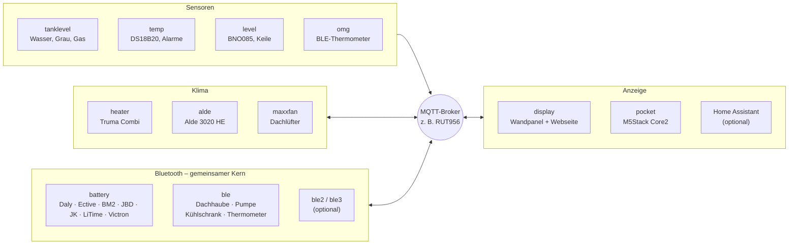

<p align="center">
  <picture>
    <source media="(prefers-color-scheme: dark)" srcset="docs/logo/vannode-logo-dark.svg">
    
  </picture>
</p>

# VanNode

Elektronik für den Camper, die über **MQTT** zusammenspielt: Tanks, Temperaturen, Batterien, Heizung, Dachlüfter, Dachhaube, Ausrichtung und zwei Displays. Jedes Gerät ist ein ESP8266/ESP32 mit eigener **Arduino**-Firmware, eigener Web-Oberfläche und Home-Assistant-Discovery. Die Geräte und Displays reden direkt über den Broker miteinander, z. B. den MQTT-Broker des LTE-Routers. Home Assistant kann mitlesen, muss aber nicht laufen.

> **Nutzung auf eigene Gefahr.** VanNode ist ein unentgeltliches Hobbyprojekt ohne Gewähr und ohne Haftung und keine Sicherheitseinrichtung. Lies den [Haftungsausschluss](#haftungsausschluss--nutzung-auf-eigene-gefahr), bevor du etwas nachbaust oder einbaust.

## Warum?

Angefangen hat alles mit Home Assistant und ESPHome. Für den Camper wurde mir das mit der Zeit zu viel: ein Server, der immer laufen muss, damit irgendetwas angezeigt wird, eine YAML-Konfiguration pro Gerät, Updates, die nebenbei etwas verändern, und viele Teile, die alle zusammenpassen müssen. Ein Fahrzeug ist oft tagelang ohne Netz und nur mit Batterie unterwegs, da wollte ich etwas Einfacheres und Robusteres.

Deshalb gilt hier:

- **Jedes Gerät funktioniert für sich allein** – mit eigener Web-Oberfläche zum Einstellen und Anschauen, auch ohne Display und ohne Server.
- **MQTT ist die einzige Verbindung.** Der Broker läuft ohnehin auf dem Router. Displays lesen direkt vom Broker.
- **Home Assistant ist eine Option, keine Voraussetzung.** Discovery ist eingebaut, wer HA nutzt, bekommt alle Geräte automatisch.
- **Updates über den Browser**, mit Prüfung der Datei und Rückfall auf die alte Firmware, wenn etwas schiefgeht.

Das ist keine Kritik an ESPHome oder Home Assistant – beide sind großartig. Für dieses eine Fahrzeug passte ein schlankerer Aufbau einfach besser.



## Geräte

| Ordner | Hardware | Aufgabe | Basis-Topic |
| --- | --- | --- | --- |
| [`firmware/tanklevel`](firmware/tanklevel) | ESP32-C3 | Frischwasser + Grauwasser (Votronic), Gasflasche (BLE) | `camper/tanklevel` |
| [`firmware/temp`](firmware/temp) | ESP8266 / ESP32-C3 | bis zu 8 DS18B20 (Kühlschrank, Gefrierfach …) mit Alarm-Grenzwerten | `camper/temp` |
| [`firmware/io`](firmware/io) | ESP32-C3 | Relais (GPIO, 74HC595, MCP23017/PCF8574), Eingänge, DS18B20 und Analogwerte, alles in der Web-Oberfläche eingerichtet | `camper/io` |
| [`firmware/ble`](firmware/ble) | ESP32-C3 / ESP32-S3 | **ble-node**: Bluetooth-Geräte als Plugins – Dachhaube RV Tech (Heki), Wasserpumpe CaraWater, WCS-Kühlschrank, Alarm WiPro III und OBD2-Adapter (nur lesen), SuperSense-Tanks und -Reifendruck, Thermometer Govee / BTHome, optional Gas (DIMES, Mopeka, Senso4s, Truma LevelControl) und eigene BLE-Sensoren; weitere Nodes als `camper/ble2` … | `camper/ble` |
| [`firmware/battery`](firmware/battery) | M5Stack AtomS3 Lite | **battery-node**: Batterien per Bluetooth (Daly BMS, Ective BM X, BM2, JBD, JK-BMS, LiTime/Redodo) und Victron Instant Readout (SmartShunt/BMV, Solarregler, Orion), Status-LED; gleicher Kern und gleiche Web-Oberfläche wie `ble` ([`firmware/_common/ble`](firmware/_common/ble)), eigene Releases | `camper/battery` |
| [`firmware/heater`](firmware/heater) | ESP32 + LIN-Transceiver | Truma Combi / Vario Heat als iNet Box am CP Plus | `camper/heater` |
| [`firmware/alde`](firmware/alde) | ESP32 + LIN-Transceiver | Alde Compact 3020 HE: liest den Heizbus passiv (Raum, Glykol, Warmwasser, Gas, Heizstab …) und setzt optional Sollwert, Gas, Heizstab und Warmwasser über den Bedienteil-Bus, in Entwicklung (basiert auf [alde-3020he-lin](https://github.com/Mellowgroup-dk/alde-3020he-lin) und [alde_3030_plus](https://github.com/daviddootson/alde_3030_plus), MIT) | `camper/alde` |
| [`firmware/maxxfan`](firmware/maxxfan) | ESP32-C3 + VanTurtle | MaxxFan-Dachlüfter | `camper/maxxfan` |
| [`firmware/level`](firmware/level) | ESP32 + BNO085 | Längs-/Querneigung und Keilhöhe für jedes Rad (basiert auf dem [Levelsensor von klehnst](https://github.com/klehnst/ESP32-Adrafruit-BNO085-HomeAssistant-Caravan-Levelsensor-MQTT), MIT) | `camper/level` |
| [`firmware/omg`](firmware/omg) | ESP32 / ESP32-C3 | Bluetooth-Thermometer (Govee, Ruuvi, Xiaomi …) über OpenMQTTGateway | `camper/OMG` |
| [`firmware/display`](firmware/display) | Guition ESP32-4848S040 | 4"-Wandpanel + gleiche Webseite fürs Handy, zeigt und steuert alles, Wetter, Warnungen, Pushover | `camper/display` |
| [`firmware/pocket`](firmware/pocket) | M5Stack Core2 | kleines mobiles Akku-Display mit Magnet (Cockpit, Küche, beim Wasserfüllen): Ausrichtung, Wasser, Gas, Temperaturen, Batterien; bis 1.5.8 „Road Buddy“ | `camper/pocket` (nur Empfänger) |

Nicht in diesem Repo: **Router-Daten (GPS, Mobilfunk)** sendet der RUT956 selbst per MQTT, siehe [Router-Daten im Display-README](firmware/display/README.md#router-daten-rut956).

- **Zu Hause testen:** [`tools/emulator`](tools/emulator) ist ein Python-Werkzeug mit lokaler Webseite. Es sendet die Topics aller Geräte, des Routers und von Zigbee mit änderbaren Werten, dazu Szenarien (Tanks laufen leer, Abfahrt, ein Gerät fällt aus …), so lassen sich die Displays ohne Fahrzeug testen
- Alle Topics auf einen Blick: [`docs/TOPICS.md`](docs/TOPICS.md)
- Klickbare Mockups aller Web-Oberflächen: [`docs/mockups/`](docs/mockups/index.html)

Die Doku der einzelnen Geräte ist auf Deutsch.

## Schnellstart

1. **Firmware holen:** Unter [Releases](https://github.com/hflocki/vannode/releases) die `.bin` des Geräts laden – oder selbst bauen (Arduino IDE oder `arduino-cli`, Einrichtung der Arduino IDE in [docs/ARDUINO.md](docs/ARDUINO.md), Besonderheiten in der README des Geräts).
2. **Einmal per USB flashen.** Danach gehen Updates über die Web-Oberfläche.
3. **Einrichten:** Ohne WLAN-Daten startet ein Access Point `<Gerät>-Node-XXXXXX`. Verbinden, `http://192.168.4.1` öffnen, WLAN und MQTT-Broker eintragen.
4. Das Gerät meldet sich unter `camper/<gerät>/…` am Broker, das Display findet es von selbst.

## Setup-WLAN und Passwörter ab Werk

Ohne eingetragenes WLAN öffnet jedes Gerät ein eigenes Setup-WLAN. Verbinden, die Seite öffnet sich meist von selbst, sonst `http://192.168.4.1`. Dort WLAN und MQTT eintragen. `XXXXXX` sind die letzten Stellen der MAC-Adresse, so lassen sich mehrere Geräte auseinanderhalten.

| Gerät | Setup-WLAN | Passwort ab Werk | Danach erreichbar unter | Setup-WLAN aktiv |
| --- | --- | --- | --- | --- |
| ble | `BLE-Node-XXXXXX` | `blenode1234` | `http://ble-node.local` (Name im Web-UI änderbar) | immer (abschaltbar) |
| battery | `Battery-Node-XXXXXX` | `battery1234` | `http://battery-node.local` (Name im Web-UI änderbar) | immer (abschaltbar) |
| tanklevel | `Tanklevel-Node-XXXXXX` | `tanklevel1234` | `http://tanklevel-node.local` | immer (abschaltbar) |
| temp | `Temp-Node-XXXXXX` | `camptemp1234` | `http://temp-node.local` | immer (abschaltbar) |
| level | `Level-Node-XXXXXX` | `level1234` | `http://level-node.local` | immer (abschaltbar) |
| maxxfan | `MaxxFan-Node-XXXXXX` | `maxxfan1234` | `http://maxxfan-node.local` | ohne WLAN |
| heater | `heater-node-XXXX` | `truma1234` | `http://heater-node.local` | ohne WLAN oder 60 s ohne Verbindung |
| alde | `Alde-Node-XXXXXX` | `alde1234` | `http://alde-node.local` | ohne WLAN oder 60 s ohne Verbindung |
| io | `IO-Node-XXXXXX` | `ionode1234` | `http://io-node.local` | ohne WLAN oder 60 s ohne Verbindung |
| display | `Display-Node-XXXXXX` | `display1234` | `http://display-node.local` | ohne WLAN oder 1 min ohne Verbindung |
| pocket | – (WLAN steht in `config_local.h`) | – | `http://pocket-node.local` (nur wach) | – |

**Login der Web-Oberfläche:** Alle Geräte-Webseiten verlangen eine Anmeldung (HTTP Basic Auth), ab Werk Benutzer **`admin`**, Passwort **`admin`** (beim Pocket-Node für die Update-Seite). Geräte, die vorher ohne Login liefen oder noch den ersten Werks-Login `vannode2026` haben, bekommen admin / admin mit dem Update; ein selbst gesetztes Passwort bleibt unverändert. Benutzer und Passwort lassen sich im Web-UI ändern (Pocket-Node: in `config_local.h`); leere Felder behalten den gespeicherten Wert, ausschalten lässt sich die Anmeldung nicht. Login vergessen: über USB im seriellen Monitor `noauth` senden (ble, battery, tanklevel, temp, level, alde, io, display), dann gilt wieder der Werks-Login. Heizung und MaxxFan haben keine serielle Konsole: dort mit **Erase All Flash** neu flashen (Einstellungen sind dann weg).

**Passwörter ändern:** Die Passwörter oben und der Werks-Login sind öffentlich (sie stehen hier). Vor dem ersten Flashen in `config_local.h` eigene setzen (`DEFAULT_AP_PASSWORD`, `DEFAULT_OTA_PASSWORD`, `DEFAULT_WEB_PASSWORD`), spätestens danach im Web-UI. Das OTA-Passwort gilt für den Netzwerk-Port der Arduino IDE.

## Gemeinsame Regeln

Alle Geräte halten sich an dasselbe Schema, damit Displays und Home Assistant sie ohne Sonderfälle verstehen:

| Was | Wie |
| --- | --- |
| Topics | `camper/<gerät>/…`, Werte **retained** |
| Verfügbarkeit | `camper/<gerät>/status` = `online` / `offline` als Last Will (retained, QoS 1) |
| Diagnose | `camper/<gerät>/info`: JSON mit Version, IP, Signal, Laufzeit |
| Befehle | `…/cmd/…` bzw. `…/set/…`, nicht retained |
| Home Assistant | Auto-Discovery unter `homeassistant/…`, ein Gerät pro Firmware |
| Einrichtung | Access Point `<Gerät>-Node-XXXXXX`, Einstellungen im Browser unter `http://192.168.4.1` |
| Web-Oberfläche | Gleiche Optik auf allen Geräten, Login immer an (HTTP Basic Auth, ab Werk `admin` / `admin`); Login vergessen → `noauth` im seriellen Monitor (Heizung, MaxxFan: Erase All Flash) |
| Updates | Im Browser, mit Prüfung (falsches Gerät, `.merged.bin`, zu groß), Ereignis-Log und Rückfall auf die vorherige Firmware |
| Update, Sicherung, Neustart | Auf allen Geräte-Webseiten dieselben Karten in derselben Reihenfolge: *Firmware- & Web-Update*, *Einstellungen sichern* (JSON-Datei ohne Passwörter und Anmeldung; WLAN/MQTT-Server nur auf Wunsch; beim Display mit Seiten, Kacheln, Automationen und Sensoren), *Ereignisse*, *Gerät* (Neustart, Werkseinstellungen) und *Über VanNode* – gemeinsame Bausteine `firmware/_common/web/vannode-system.js` und `vannode-backup.js` |
| Uhrzeit | Geräte mit Uhr (Display, Heizung, ble, battery) fragen NTP und den Router; ohne Internet übernimmt die Webseite die Zeit vom Handy (Karte *Uhrzeit*, auch von Hand setzbar) |
| Firmware-Version | `FW_VERSION` in der `config.h` des Geräts, sichtbar im Web-UI und in HA |

## Eigene Einstellungen (`config_local.h`)

Passwörter, WLAN und Broker gehören nicht ins Repo. Jedes Gerät hat dafür neben seiner `config.h` eine Vorlage `config_local.h.example`:

```bash
cd firmware/temp/camper_temp
cp config_local.h.example config_local.h   # then edit
```

Alles, was in `config_local.h` steht, gilt statt des Standardwerts aus `config.h`. Die Datei ist per `.gitignore` ausgeschlossen, landet also nie auf GitHub, und Updates oder Patches überschreiben sie nicht. Typisch:

| Wert | Wirkung |
| --- | --- |
| `DEFAULT_AP_PASSWORD` | Passwort des Setup-Access-Points |
| `DEFAULT_OTA_PASSWORD` | Passwort für Updates über den Netzwerk-Port der Arduino IDE |
| `DEFAULT_WIFI_SSID` / `DEFAULT_WIFI_PASSWORD` | WLAN, mit dem sich ein frisch geflashtes Gerät sofort verbindet |
| `DEFAULT_MQTT_SERVER`, `_USER`, `_PASSWORD` | Broker ab Werk |
| `DEFAULT_WEB_USER` / `DEFAULT_WEB_PASSWORD` | Login für die Web-Oberfläche ab Werk |

Außerdem lässt sich jeder andere Wert aus `config.h` überschreiben (Pins, Prefix, Tankgröße …).

Wichtig: WLAN, MQTT und Login ab Werk wirken nur, solange auf dem Gerät noch nichts gespeichert ist (Ausnahme: ein Gerät ganz ohne gespeicherten Login bekommt beim Start den Werks-Login). Ein normales Update über bestehende Einstellungen ändert sie nicht. Neu übernommen werden sie nach **Werkseinstellungen** im Web-UI, nach dem Flashen mit **Erase All Flash Before Sketch Upload: Enabled** (Arduino IDE, Menü Werkzeuge) bzw. bei temp, tanklevel und level nach dem Hochladen des LittleFS-Images. Die Passwörter für Access Point und OTA gelten dagegen immer sofort.

Die Pocket-Node hat keine Einstellungsseite, nur eine Update-Seite; WLAN und MQTT kommen deshalb nur über `config_local.h` (Namen siehe seine README). Eine Firmware mit eigener `config_local.h` speichert die Zugangsdaten im Flash, damit die Actions-Firmware danach per Update-Seite installiert werden kann.

## Warnungen

`firmware/temp` meldet überschrittene Grenzwerte (z. B. „Kühlschrank über 8 °C seit 15 min“) unter `camper/temp/alarm_text`. Das Wandpanel zeigt diese, Heizungsfehler, Batterie-, Tank-, Frost- und Wetter-Warnungen in der Status-Kachel und als gelbes Band in der Kopfzeile, auf Wunsch auch per **Pushover** aufs Handy – mit eigener Dringlichkeit je Warnungsart bis hin zum Notfall, der klingelt, bis man ihn bestätigt. In Home Assistant gibt es dieselben Alarme als Binärsensoren.

## Fertige Firmware

Jeder Push baut alle Geräte per GitHub Actions ([`.github/workflows/build.yml`](.github/workflows/build.yml)), mit genau den Board-Paket- und Bibliotheksversionen aus [docs/ARDUINO.md](docs/ARDUINO.md) (geprüft von `tools/docs/check_arduino.py`). Die `.bin` liegt beim jeweiligen Lauf im Reiter **Actions** zum Download.

Ein Release für **ein** Gerät entsteht mit einem Tag `<gerät>-v<version>`:

```bash
git tag temp-v1.1.0
git push origin temp-v1.1.0
```

Vorher `FW_VERSION` erhöhen und oben in `firmware/<gerät>/CHANGELOG.md` eine Zeile für die Version schreiben – sie wird der Text des Releases. Passt der Tag nicht zur `FW_VERSION` oder fehlt die Zeile, bricht die CI vor dem Bauen ab (`tools/release/check.py`). Alles vorab prüfen und die Befehle ausgeben lassen:

```bash
python3 tools/release/release.py temp
```

Dann wird nur dieses Gerät gebaut und die `.bin` ans Release gehängt. Alle Geräte spielen sie über ihre Web-Oberfläche ein (Pocket-Node über ihre Update-Seite). Bei temp, tanklevel, level, maxxfan und ble liegt die Web-Oberfläche außerdem als `data/index.html.gz` im Sketch-Ordner; sie hängt als `<gerät>-node-web-v<version>.html.gz` mit am Release und wird nach dem Firmware-Update separat hochgeladen.

**Namen:** Jedes Gerät heißt `<gerät>-node` – Hostname (`temp-node.local`), Setup-WLAN (`Temp-Node-XXXXXX`) und Release-Datei mit der Firmware-Version (`temp-node-esp32c3-v1.4.2.bin`). Die MQTT-Topics bleiben `camper/<gerät>/…`, die Home-Assistant-IDs bleiben gleich.

**Alle Geräte in einem Release:** Ein Tag `bundle-v<version>` baut alle Geräte und legt ein Release mit den Dateien an, die in [`.github/bundle.txt`](.github/bundle.txt) stehen (ein Gerät mit Ziel pro Zeile, z. B. `heater esp32`). Was gebaut wird, aber bewusst nicht ins Paket soll, steht dort als `# skip: <gerät> <ziel>`; sonst meldet `tools/release/check.py` eine Warnung. Dazu kommen die Webseiten als `<gerät>-node-web.html.gz` und eine Tabelle mit allen Versionen. Alles zusammen gibt es dort zusätzlich als **eine ZIP-Datei** `vannode-<version>.zip` (mit `LICENSE` und `NOTICE.md`), zum Herunterladen mit einem Klick.

```bash
git tag bundle-v2026.11.07
git push origin bundle-v2026.11.07
```

## Nur ein Gerät nachbauen

Einfach den Ordner des Geräts nehmen und dessen README folgen. Wer nicht das ganze Repo laden will:

```bash
git clone --filter=blob:none --sparse https://github.com/hflocki/vannode.git
cd vannode
git sparse-checkout set firmware/temp
```

## Neues Gerät

[`firmware/_template`](firmware/_template) ist ein lauffähiges Muster-Gerät mit allem Gemeinsamen (WLAN mit Setup-WLAN, Web-Oberfläche, Einstellungen, MQTT mit Home-Assistant-Discovery, Updates ohne USB). Ein Befehl kopiert es als neues Gerät, danach füllst du nur noch den Sensor-Teil (`sensor.cpp`). Anleitung: [`firmware/_template/ANLEITUNG.md`](firmware/_template/ANLEITUNG.md).

```bash
python firmware/_template/tools/new_device.py waste "Abwasser"
```

Jeder Ordner hat eine eigene README mit Hardware, Besonderheiten beim Bauen und Topics (Gemeinsames zur Arduino IDE in [docs/ARDUINO.md](docs/ARDUINO.md)), Arduino-Sketch im Unterordner mit dem Namen der `.ino` (z. B. `camper_temp/`, Heizung `truma_heater/`). Gebaut wird nur mit Arduino (IDE oder `arduino-cli`), PlatformIO nur beim Bluetooth-Gateway `firmware/omg`, weil OpenMQTTGateway ein fremdes PlatformIO-Projekt ist.

## Mockups

Unter [`docs/mockups/`](docs/mockups/index.html) liegt von jeder Web-Oberfläche ein klickbares Mockup: die echte Seite aus der Firmware mit simulierten Daten. Knöpfe, Einstellungen, Speichern und Upload reagieren wie am Gerät, es wird aber nichts gesendet. `index.html` zeigt alle Geräte nebeneinander in Handygröße. Der Designentwurf, nach dem sich alle Seiten richten (Farben, Schrift, Symbole, Bausteine und Entwürfe der Display-Webseite), liegt in [`docs/mockups/design/`](docs/mockups/design/system.html) und ist im selben Index verlinkt.

Zum Ansehen den Ordner herunterladen und `index.html` im Browser öffnen. Nach Änderungen an einer Web-Oberfläche neu erzeugen (nur Python-Standardbibliothek, kein venv nötig):

```bash
python3 tools/mockups/make_mockups.py
```

Die Beispieldaten und das simulierte Verhalten stehen je Gerät in `tools/mockups/mock/<gerät>.js`, der gemeinsame Teil (fetch, WebSocket, Upload) in `core.js`. Bei einem neuen Gerät dort eine Datei anlegen und es in `make_mockups.py` eintragen. Die Pocket-Node hat nur eine kleine Update-Seite und fehlt deshalb.

## Herkunft

Die Geräte waren vorher einzelne Repos (`camper-tanklevel`, `camper-temp`, `camper-heater`, `camper-maxxfan`, `camper-display`, `m5core2-roadbuddy`, `camper_toolbox`). Sie wurden hierher übernommen (`firmware/battery` war von ble 2.0 bis 2.4 Teil von `firmware/ble` und hat seit 2.5.0 wieder eine eigene Firmware); die alten Repos sind archiviert bzw. werden es.

## Danke

Mein Dank geht an **mot flash** für das Testen und die Anregung, die BLE-Plugins für die Dachhaube RV Tech, den Kühlschrank WCS und die Wasserpumpe CaraWater zu bauen.

## Bitte um Nennung

VanNode ist ein Hobbyprojekt mit viel Arbeit dahinter. Wenn du Code, Protokolle oder Ideen daraus
für dein eigenes Projekt nutzt – auch privat –, nenne bitte VanNode mit Link auf
<https://github.com/hflocki/vannode>. Das ist eine Bitte, keine Lizenzbedingung. Wer Code aus
VanNode weitergibt, muss die Hinweise ohnehin stehen lassen (siehe [Lizenz](#lizenz)).

Zum Kopieren:

Für eine README (Markdown):

```markdown
Basiert auf / angeregt durch [VanNode](https://github.com/hflocki/vannode) von hflocki.
```

Für Quellcode:

```c
// Based on / inspired by VanNode by hflocki - https://github.com/hflocki/vannode
```

Für einen Forenbeitrag oder eine Videobeschreibung:

```text
Idee / Protokoll aus VanNode von hflocki: https://github.com/hflocki/vannode
```

Danke!

## Buy me a coffee

Wenn dir VanNode nützt und du Danke sagen möchtest, kannst du mir gern einen Kaffee spendieren. Die
Spende ist völlig freiwillig: Sie ist ein Dankeschön, keine Bezahlung. Sie kauft keinen Support,
keine Funktionen, keine Antwortzeit und keine andere Leistung, und VanNode bleibt für alle gleich, ob
sie spenden oder nicht.

[](https://www.buymeacoffee.com/hflocki)

Oder direkt: [buymeacoffee.com/hflocki](https://www.buymeacoffee.com/hflocki)

## Haftungsausschluss – Nutzung auf eigene Gefahr

VanNode ist ein privates Hobbyprojekt, unentgeltlich und ohne Geschäftstätigkeit. Es überwacht und
schaltet echte Technik im Fahrzeug (Heizung, Gas- und Wassertank, Wasserpumpe, Dachhaube und
Dachlüfter, Batterien). Fehler in Software, Einstellungen, Hardware oder Einbau können Geräte, das
Fahrzeug oder andere Sachen beschädigen und Menschen gefährden.

- Nachbau, Einbau und Nutzung erfolgen vollständig auf eigene Gefahr und eigene Verantwortung.
- VanNode ist keine Sicherheitseinrichtung. Es ersetzt weder die Steuerungen und Schutzfunktionen
  der Hersteller noch Gas-, CO- oder Rauchmelder, das Frostwächter-Ventil oder regelmäßige
  Kontrollen. Angezeigte Werte und Warnungen können falsch sein, zu spät kommen oder ausbleiben –
  verlass dich nicht darauf.
- Arbeiten an Gasanlage, 230 V und Fahrzeugelektrik nur durch Fachkundige, unter Beachtung der
  geltenden Vorschriften und der Anleitungen der Hersteller. Der Anschluss an fremde Geräte kann
  deren Garantie, Gewährleistung oder Zulassung gefährden.
- Soweit gesetzlich zulässig, haftet der Autor nicht für Schäden jeder Art, die aus der Nutzung von
  VanNode, seiner Dokumentation oder damit gebauter Geräte entstehen oder daraus, dass sie nicht
  genutzt werden können (siehe auch Abschnitte 15 und 16 der GNU GPL v3). Unberührt bleibt nur die
  Haftung, die gesetzlich nicht ausgeschlossen werden kann, insbesondere bei Vorsatz und grober
  Fahrlässigkeit, bei Verletzung von Leben, Körper oder Gesundheit und nach zwingendem
  Produkthaftungsrecht, soweit es anwendbar ist.

## Marken

Produkt- und Firmennamen in diesem Projekt – zum Beispiel Truma, Combi, CP Plus, CaraWater, Daly,
Ective, JBD, JK-BMS, LiTime, Redodo, Victron, Senso4s, Govee, Mopeka, MaxxFan, Heki, Votronic, Xiaomi, M5Stack, Espressif, Guition, SMLIGHT,
Teltonika und Home Assistant – sind Marken oder eingetragene Marken ihrer Inhaber. Sie stehen hier
nur, um passende Geräte zu benennen. VanNode hat keine Verbindung zu diesen Inhabern und wird von
ihnen weder unterstützt noch geprüft oder empfohlen. Die Protokolle stammen aus öffentlichen
Open-Source-Projekten oder wurden nur ermittelt, damit die Geräte zusammenarbeiten
(Interoperabilität).

## Lizenz

VanNode steht unter der **GNU General Public License Version 3** ([`LICENSE`](LICENSE)) mit
zusätzlichen Bedingungen nach Abschnitt 7 ([`NOTICE.md`](NOTICE.md)):

- der Urhebervermerk „Copyright © 2026 hflocki“, der Link zum Projekt und die Lizenzangaben, die die
  Geräte anzeigen (Karte „Über VanNode“ auf allen Geräte-Webseiten, Display-Info, Wandpanel), bleiben
  in allen Kopien und veränderten Fassungen erhalten;
- veränderte Fassungen müssen als solche gekennzeichnet sein und dürfen nicht als eigenes Werk
  ausgegeben werden;
- Name und Logo „VanNode“ sind nicht Teil der Lizenz: Forks brauchen einen eigenen Namen und ein
  eigenes Logo ([`NAME-UND-LOGO.md`](NAME-UND-LOGO.md)).

Verkaufen erlaubt die GPL, wenn der vollständige Quellcode und diese Hinweise mitgegeben werden.

Fremde Teile behalten ihre Lizenz. Die vollständige Liste, nach Node sortiert, steht nur zentral in der [`NOTICE.md`](NOTICE.md); die Geräte verlinken in der Karte „Über VanNode“ dorthin. Kurzüberblick:

| Ordner | Fremde Teile |
| --- | --- |
| `firmware/heater` | Protokoll-Logik aus [esphome-truma_inetbox](https://github.com/skrebber/esphome-truma_inetbox) und Timer aus [esphome-truma](https://github.com/havanti/esphome-truma) (GPL-3.0), Test-Mitschnitte aus [WomoLIN](https://github.com/muccc/WomoLIN) (GPL-3.0) |
| `firmware/alde` | LIN-Dekodierung aus [alde-3020he-lin](https://github.com/Mellowgroup-dk/alde-3020he-lin) (Code MIT, Dokumentation CC BY 4.0), Protokoll des Bedienteil-Busses aus [alde_3030_plus](https://github.com/daviddootson/alde_3030_plus) (MIT), Prüfsummen-Erkennung nach [esphome-alde-3020](https://github.com/holdestmade/esphome-alde-3020) (MIT) |
| `firmware/battery` | Batterie-Protokolle (Daly, Ective, BM2, JBD, JK-BMS, LiTime) und Test-Mitschnitte aus [aiobmsble](https://github.com/patman15/aiobmsble) (Apache-2.0), Victron Instant Readout nach [victron-ble](https://github.com/keshavdv/victron-ble) (Unlicense) |
| `firmware/ble` | Dachhauben-Protokoll aus [rvtech-hacs](https://github.com/C64Axel/rvtech-hacs) (MIT), Pumpen-Protokoll nach [toms2k84/Blackforest-Vanlife-SmartCamper](https://github.com/toms2k84/Blackforest-Vanlife-SmartCamper) (MIT) und [geierwally1978/carawater-isp15-ble](https://github.com/geierwally1978/carawater-isp15-ble) (eigene Umsetzung, kein Code übernommen), SuperSense-Tanksensor nach [adahmen/supersense-homeassistant](https://github.com/adahmen/supersense-homeassistant) (MIT, eigene Umsetzung), Truma LevelControl nach [HAOS-Truma-Levelcontrol-Integration](https://github.com/cyclemat/HAOS-Truma-Levelcontrol-Integration) (GPL-3.0), Senso4s nach [senso4s_ble](https://github.com/ksanislo/senso4s_ble) (Apache-2.0) |
| `firmware/tanklevel` | Mopeka-Dekodierung nach [mopeka-iot-ble](https://github.com/Bluetooth-Devices/mopeka-iot-ble), SuperSense-Tanksensor nach [adahmen/supersense-homeassistant](https://github.com/adahmen/supersense-homeassistant) (beide MIT, eigene Umsetzung) |
| `firmware/level` | basiert auf dem Levelsensor von [klehnst](https://github.com/klehnst/ESP32-Adrafruit-BNO085-HomeAssistant-Caravan-Levelsensor-MQTT) (MIT) |
| `firmware/display` | Schriften Montserrat und Font Awesome Free (OFL), Truma-Fehlertexte (eigene Formulierung), microlink (MIT) mit wireguard-lwip (BSD-3-Clause) für Tailscale |
| `firmware/omg` | OpenMQTTGateway (GPL-3.0), wird beim Bauen heruntergeladen |

