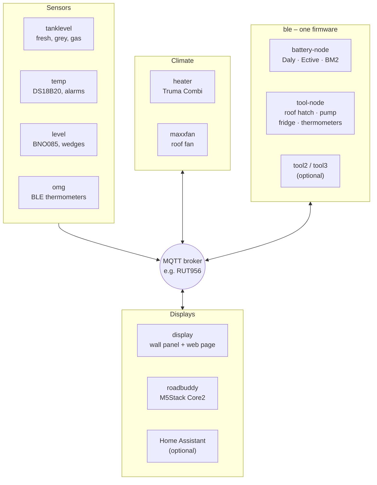

<p align="center">
  <picture>
    <source media="(prefers-color-scheme: dark)" srcset="docs/logo/vannode-logo-dark.svg">
    
  </picture>
</p>

# VanNode

🇬🇧 English · 🇩🇪 [Deutsch](README.de.md)

Electronics for a camper van that work together over **MQTT**: tanks, temperatures, batteries, heater, roof fan, roof hatch, levelling and two displays. Every device is an ESP8266/ESP32 with its own **Arduino** firmware, its own web interface and Home Assistant discovery. Devices and displays talk to each other directly through the broker, e.g. the MQTT broker of the LTE router. Home Assistant can listen in, but it does not have to run.

> **Use at your own risk.** VanNode is a free hobby project without any warranty or liability and it is not a safety device. Read [No warranty, no liability](#no-warranty-no-liability--use-at-your-own-risk) before you build or install anything.

## Why?

It all started with Home Assistant and ESPHome. For the camper, that became too much over time: a server that has to run before anything shows up, a YAML configuration per device, updates that change things on the side, and many parts that all have to fit together. A vehicle is often off-grid for days and runs on battery, so I wanted something simpler and more robust.

So the rules here are:

- **Every device works on its own** – with its own web interface for settings and values, even without a display and without a server.
- **MQTT is the only link.** The broker runs on the router anyway. The displays read straight from the broker.
- **Home Assistant is an option, not a requirement.** Discovery is built in; if you use HA, all devices show up automatically.
- **Updates in the browser**, with a check of the file and a fallback to the previous firmware if something goes wrong.

This is not criticism of ESPHome or Home Assistant – both are great. For this one vehicle a leaner setup simply fit better.



## Devices

| Folder | Hardware | Purpose | Base topic |
| --- | --- | --- | --- |
| [`firmware/tanklevel`](firmware/tanklevel) | ESP32-C3 | Fresh and grey water (Votronic), gas bottle (BLE) | `camper/tanklevel` |
| [`firmware/temp`](firmware/temp) | ESP8266 / ESP32-C3 | up to 8 DS18B20 (fridge, freezer …) with alarm limits | `camper/temp` |
| [`firmware/ble`](firmware/ble) | ESP32-C3 / AtomS3 | One firmware for all Bluetooth devices as plugins. Runs twice: **battery-node** (Daly BMS, Ective BM X, BM2) and **tool-node** (RV Tech roof hatch (Heki), CaraWater pump, WCS fridge, Govee / BTHome thermometers, optionally gas and own BLE sensors) | `camper/battery`, `camper/tool` |
| [`firmware/heater`](firmware/heater) | ESP32 + LIN transceiver | Truma Combi / Vario Heat as an iNet Box on the CP Plus | `camper/heater` |
| [`firmware/maxxfan`](firmware/maxxfan) | ESP32-C3 + VanTurtle | MaxxFan roof fan | `camper/maxxfan` |
| [`firmware/level`](firmware/level) | ESP32 + BNO085 | Pitch, roll and wedge height for every wheel (based on the [level sensor by klehnst](https://github.com/klehnst/ESP32-Adrafruit-BNO085-HomeAssistant-Caravan-Levelsensor-MQTT), MIT) | `camper/level` |
| [`firmware/omg`](firmware/omg) | ESP32 / ESP32-C3 | Bluetooth thermometers (Govee, Ruuvi, Xiaomi …) through OpenMQTTGateway | `camper/OMG` |
| [`firmware/display`](firmware/display) | Guition ESP32-4848S040 | 4" wall panel + the same page for the phone: shows and controls everything, weather, warnings, Pushover | `camper/display` |
| [`firmware/roadbuddy`](firmware/roadbuddy) | M5Stack Core2 | small battery display: levelling, water, gas | – (receive only) |

Not in this repo: **router data (GPS, mobile signal)** is sent by the RUT956 itself over MQTT, see [router data in the display README](firmware/display/README.md#router-daten-rut956).

- **Testing at home:** [`tools/emulator`](tools/emulator) is a Python tool with a local web page. It sends the topics of all devices, the router and Zigbee with values you can change, plus scenarios (tanks running empty, departure, a device dropping out …), so the displays can be tested without the vehicle
- All topics at a glance: [`docs/TOPICS.md`](docs/TOPICS.md)
- Clickable mockups of every web interface: [`docs/mockups/`](docs/mockups/index.html)
- Notes for AI assistants and contributors: [`AGENTS.md`](AGENTS.md)

The documentation of the individual devices and the web interfaces are in German.

## Quick start

1. **Get the firmware:** download the device's `.bin` from [Releases](https://github.com/hflocki/vannode/releases) – or build it yourself (Arduino IDE or `arduino-cli`; board and libraries are listed in the device README).
2. **Flash once over USB.** After that, updates go through the web interface.
3. **Set up:** without WiFi credentials the device opens an access point `<device>-Node-XXXXXX`. Connect, open `http://192.168.4.1`, enter WiFi and MQTT broker.
4. The device appears under `camper/<device>/…` on the broker; the display finds it by itself.

## Common rules

All devices follow the same scheme, so the displays and Home Assistant understand them without special cases:

| What | How |
| --- | --- |
| Topics | `camper/<device>/…`, values **retained** |
| Availability | `camper/<device>/status` = `online` / `offline` as last will (retained, QoS 1) |
| Diagnostics | `camper/<device>/info`: JSON with version, IP, signal, uptime |
| Commands | `…/cmd/…` or `…/set/…`, not retained |
| Home Assistant | auto discovery under `homeassistant/…`, one device per firmware |
| Setup | access point `<device>-Node-XXXXXX`, settings in the browser at `http://192.168.4.1` |
| Web interface | same look on every device, optional login (HTTP basic auth); forgot the login → `noauth` in the serial monitor or factory reset |
| Updates | in the browser, with checks (wrong device, `.merged.bin`, too large), event log and fallback to the previous firmware |
| Firmware version | `FW_VERSION` in the device's `config.h`, shown in the web UI and in HA |

## Your own settings (`config_local.h`)

Passwords, WiFi and broker do not belong in the repo. Next to its `config.h`, every device has a template `config_local.h.example`:

```bash
cd firmware/temp/camper_temp
cp config_local.h.example config_local.h   # then edit
```

Everything in `config_local.h` replaces the default from `config.h`. The file is excluded by `.gitignore`, so it never ends up on GitHub, and updates or patches do not overwrite it. Typical values:

| Value | Effect |
| --- | --- |
| `DEFAULT_AP_PASSWORD` | password of the setup access point |
| `DEFAULT_OTA_PASSWORD` | password for updates through the network port of the Arduino IDE |
| `DEFAULT_WIFI_SSID` / `DEFAULT_WIFI_PASSWORD` | WiFi a freshly flashed device joins right away |
| `DEFAULT_MQTT_SERVER`, `_USER`, `_PASSWORD` | factory broker |
| `DEFAULT_WEB_USER` / `DEFAULT_WEB_PASSWORD` | factory login for the web interface |

Any other value from `config.h` can be overridden as well (pins, prefix, tank size …).

Note: factory WiFi, MQTT and login only apply while nothing is stored on the device yet. A normal update over existing settings does not change them. They are taken over again after a **factory reset** in the web UI, after flashing with **Erase All Flash Before Sketch Upload: Enabled** (Arduino IDE, Tools menu), or for temp, tanklevel and level after uploading the LittleFS image. The access point and OTA passwords always apply immediately.

The Road Buddy has no settings page, only an update page; there the whole `config.h` is the personal file (template `config.example.h`). A firmware built with your own `config.h` stores the credentials in flash, so the Actions firmware can be installed through the update page afterwards.

## Warnings

`firmware/temp` reports exceeded limits (e.g. "fridge above 8 °C for 15 min") under `camper/temp/alarm_text`. The wall panel shows these, heater errors and battery, tank, frost and weather warnings in the status tile and as a yellow banner in the header – optionally also as a **Pushover** message on the phone, with its own priority per kind of warning, up to an emergency that keeps ringing until it is confirmed. Home Assistant gets the same alarms as binary sensors.

## Ready-made firmware

Every push builds all devices with GitHub Actions ([`.github/workflows/build.yml`](.github/workflows/build.yml)), using exactly the board package and library versions from the device READMEs. The `.bin` files are available in the **Actions** tab of each run.

A release for **one** device is made with a tag `<device>-v<version>`:

```bash
git tag temp-v1.1.0
git push origin temp-v1.1.0
```

Then only this device is built and the `.bin` is attached to the release. All devices install it through their web interface (Road Buddy through its update page). For temp, tanklevel, level, maxxfan and ble the web interface also lives as `data/index.html.gz` in the sketch folder and is uploaded separately after an update.

**Names:** every device is called `<device>-node` – hostname (`temp-node.local`), setup access point (`Temp-Node-XXXXXX`) and release file with the firmware version (`temp-node-esp32c3-v1.4.2.bin`). MQTT topics stay `camper/<device>/…`, Home Assistant IDs stay unchanged.

**All devices in one release:** a tag `bundle-v<version>` builds every device and creates one release with the files listed in [`.github/bundle.txt`](.github/bundle.txt) (one device and target per line, e.g. `heater esp32`), plus the web pages as `<device>-node-web.html.gz` and a table of all versions.

```bash
git tag bundle-v2026.11.07
git push origin bundle-v2026.11.07
```

## Build just one device

Take the device folder and follow its README. If you do not want the whole repo:

```bash
git clone --filter=blob:none --sparse https://github.com/hflocki/vannode.git
cd vannode
git sparse-checkout set firmware/temp
```

## New device

[`firmware/_template`](firmware/_template) is a working sample device with everything shared (WiFi with setup access point, web interface, settings, MQTT with Home Assistant discovery, updates without USB). One command copies it as a new device; then you only fill in the sensor part (`sensor.cpp`). Guide (German): [`firmware/_template/ANLEITUNG.md`](firmware/_template/ANLEITUNG.md).

```bash
python firmware/_template/tools/new_device.py waste "Abwasser"
```

Every folder is complete on its own: its own README with hardware, board settings, libraries and topics, the Arduino sketch in a subfolder named like the `.ino` (e.g. `camper_temp/`, heater `truma_heater/`). Everything is built with Arduino (IDE or `arduino-cli`); PlatformIO is only used for the Bluetooth gateway `firmware/omg`, because OpenMQTTGateway is a third-party PlatformIO project.

## Mockups

[`docs/mockups/`](docs/mockups/index.html) has a clickable mockup of every web interface: the real page from the firmware with simulated data. Buttons, settings, saving and uploads react like on the device, but nothing is sent. `index.html` shows all devices side by side in phone size. The design draft that all pages follow (colours, type, icons, building blocks, plus drafts of the display page) is in [`docs/mockups/design/`](docs/mockups/design/system.html) and linked from the same index.

To view them, download the folder and open `index.html` in a browser. Regenerate after changing a web interface (Python standard library only, no venv needed):

```bash
python3 tools/mockups/make_mockups.py
```

Sample data and simulated behaviour per device are in `tools/mockups/mock/<device>.js`, the shared part (fetch, WebSocket, upload) in `core.js`. For a new device, add a file there and register it in `make_mockups.py`. The Road Buddy only has a small update page and is therefore missing.

## Origin

The devices used to be separate repos (`camper-tanklevel`, `camper-temp`, `camper-heater`, `camper-maxxfan`, `camper-display`, `m5core2-roadbuddy`, `camper_toolbox`). They were moved here (the former `firmware/battery` is now part of `firmware/ble`); the old repos are or will be archived.

## No warranty, no liability – use at your own risk

VanNode is a private hobby project. It is given away free of charge and without any business
activity. It monitors and switches real equipment in a vehicle (heater, gas and water tanks, water
pump, roof hatch and roof fan, batteries). Faults in the software, the settings, the hardware or the
installation can damage devices, the vehicle or other property and can put people at risk.

- Building, installing and using VanNode is entirely at your own risk and responsibility.
- VanNode is not a safety device. It does not replace the controls and protective functions of the
  device manufacturers, gas, CO or smoke detectors, the frost protection valve or regular checks.
  Values and warnings shown by VanNode can be wrong, late or missing – do not rely on them.
- Work on gas installations, 230 V and the vehicle's electrical system must only be done by
  qualified persons, following the applicable regulations and the manufacturers' instructions.
  Connecting VanNode to third-party devices may void their warranty, guarantee or approval.
- To the extent permitted by applicable law, the author accepts no liability for damage of any kind
  resulting from the use of VanNode, its documentation or devices built with it, or from the fact
  that they cannot be used (see also sections 15 and 16 of the GNU GPL v3). Only liability that
  cannot be excluded by law remains, in particular for intent and gross negligence, for injury to
  life, body or health and under mandatory product liability law, where it applies.

## Trademarks

Product and company names used in this project – for example Truma, Combi, CP Plus, CaraWater,
Daly, Ective, Govee, Mopeka, MaxxFan, Heki, Votronic, Xiaomi, M5Stack, Espressif, Guition, SMLIGHT,
Teltonika and Home Assistant – are trademarks or registered trademarks of their respective owners.
They are used only to name compatible devices. VanNode is not affiliated with, endorsed, supported
or certified by any of these owners. Protocols are taken from public open-source projects or were
determined only to make the devices work together (interoperability).

## License

VanNode is licensed under the **GNU General Public License version 3** ([`LICENSE`](LICENSE)) with
additional terms under section 7 ([`NOTICE.md`](NOTICE.md)):

- the author attribution "Copyright © 2026 hflocki", the project link and the license information
  shown by the devices (card "Über VanNode", display info, wall panel, Road Buddy update page) must
  stay in all copies and modified versions;
- modified versions must be marked as such and must not be passed off as one's own work;
- the name "VanNode" and its logo are not part of the license: forks need their own name and logo
  ([`NAME-UND-LOGO.md`](NAME-UND-LOGO.md), German).

Selling is allowed under the GPL, as long as the complete source code and these notices go with it.

Third-party parts keep their licenses and are listed in [`NOTICE.md`](NOTICE.md):

| Folder | Third-party parts |
| --- | --- |
| `firmware/heater` | protocol logic from [esphome-truma_inetbox](https://github.com/skrebber/esphome-truma_inetbox) and timer from [esphome-truma](https://github.com/havanti/esphome-truma) (GPL-3.0), test captures from [WomoLIN](https://github.com/muccc/WomoLIN) (GPL-3.0) |
| `firmware/ble` | battery protocols from [aiobmsble](https://github.com/patman15/aiobmsble) (Apache-2.0), roof hatch protocol from [rvtech-hacs](https://github.com/C64Axel/rvtech-hacs) (MIT), pump protocol after [toms2k84/Blackforest-Vanlife-SmartCamper](https://github.com/toms2k84/Blackforest-Vanlife-SmartCamper) (MIT) and [geierwally1978/carawater-isp15-ble](https://github.com/geierwally1978/carawater-isp15-ble) (own implementation, no code copied) |
| `firmware/level` | based on the level sensor of [klehnst](https://github.com/klehnst/ESP32-Adrafruit-BNO085-HomeAssistant-Caravan-Levelsensor-MQTT) (MIT) |
| `firmware/display` | fonts Montserrat and Font Awesome Free (OFL), Truma fault texts (own wording) |
| `firmware/omg` | OpenMQTTGateway (GPL-3.0), downloaded at build time |

