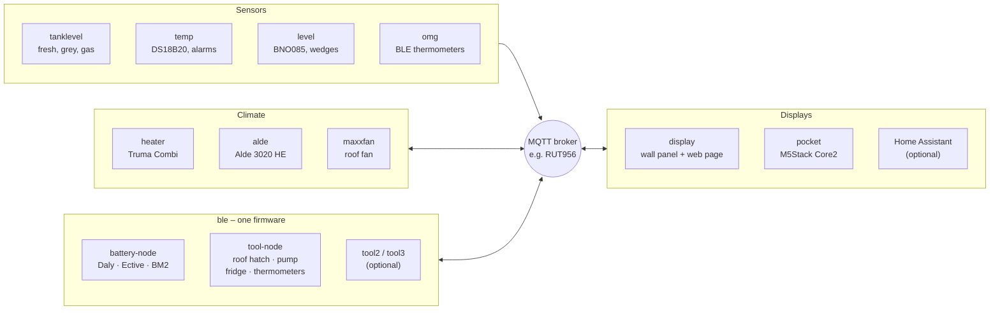

<p align="center">
  <picture>
    <source media="(prefers-color-scheme: dark)" srcset="docs/logo/vannode-logo-dark.svg">
    
  </picture>
</p>

# VanNode

🇬🇧 English · 🇩🇪 [Deutsch](README.de.md)

Electronics for a camper van that work together over **MQTT**: tanks, temperatures, batteries, heater, roof fan, roof hatch, levelling and two displays. Every device is an ESP8266/ESP32 with its own **Arduino** firmware, its own web interface and Home Assistant discovery. Devices and displays talk to each other directly through the broker, e.g. the MQTT broker of the LTE router. Home Assistant can listen in, but it does not have to run.

> **Use at your own risk.** VanNode is a free hobby project without any warranty or liability and it is not a safety device. Read [No warranty, no liability](#no-warranty-no-liability--use-at-your-own-risk) before you build or install anything.

## Why?

It all started with Home Assistant and ESPHome. For the camper, that became too much over time: a server that has to run before anything shows up, a YAML configuration per device, updates that change things on the side, and many parts that all have to fit together. A vehicle is often off-grid for days and runs on battery, so I wanted something simpler and more robust.

So the rules here are:

- **Every device works on its own** – with its own web interface for settings and values, even without a display and without a server.
- **MQTT is the only link.** The broker runs on the router anyway. The displays read straight from the broker.
- **Home Assistant is an option, not a requirement.** Discovery is built in; if you use HA, all devices show up automatically.
- **Updates in the browser**, with a check of the file and a fallback to the previous firmware if something goes wrong.

This is not criticism of ESPHome or Home Assistant – both are great. For this one vehicle a leaner setup simply fit better.



## Devices

| Folder | Hardware | Purpose | Base topic |
| --- | --- | --- | --- |
| [`firmware/tanklevel`](firmware/tanklevel) | ESP32-C3 | Fresh and grey water (Votronic), gas bottle (BLE) | `camper/tanklevel` |
| [`firmware/temp`](firmware/temp) | ESP8266 / ESP32-C3 | up to 8 DS18B20 (fridge, freezer …) with alarm limits | `camper/temp` |
| [`firmware/ble`](firmware/ble) | ESP32-C3 / ESP32-S3 / AtomS3 | One firmware for all Bluetooth devices as plugins. Runs twice: **battery-node** (Daly BMS, Ective BM X, BM2) and **tool-node** (RV Tech roof hatch (Heki), CaraWater pump, WCS fridge, OBD2 adapter (vehicle values, read only), Govee / BTHome thermometers, optionally gas and own BLE sensors) | `camper/battery`, `camper/tool` |
| [`firmware/heater`](firmware/heater) | ESP32 + LIN transceiver | Truma Combi / Vario Heat as an iNet Box on the CP Plus | `camper/heater` |
| [`firmware/alde`](firmware/alde) | ESP32 + LIN transceiver | Alde Compact 3020 HE: reads the heater bus passively (room, glycol, hot water, gas, electric power …) and optionally sets setpoint, gas, electric level and hot water through the external panel bus, in development (based on [alde-3020he-lin](https://github.com/Mellowgroup-dk/alde-3020he-lin) and [alde_3030_plus](https://github.com/daviddootson/alde_3030_plus), MIT) | `camper/alde` |
| [`firmware/maxxfan`](firmware/maxxfan) | ESP32-C3 + VanTurtle | MaxxFan roof fan | `camper/maxxfan` |
| [`firmware/level`](firmware/level) | ESP32 + BNO085 | Pitch, roll and wedge height for every wheel (based on the [level sensor by klehnst](https://github.com/klehnst/ESP32-Adrafruit-BNO085-HomeAssistant-Caravan-Levelsensor-MQTT), MIT) | `camper/level` |
| [`firmware/omg`](firmware/omg) | ESP32 / ESP32-C3 | Bluetooth thermometers (Govee, Ruuvi, Xiaomi …) through OpenMQTTGateway | `camper/OMG` |
| [`firmware/display`](firmware/display) | Guition ESP32-4848S040 | 4" wall panel + the same page for the phone: shows and controls everything, weather, warnings, Pushover | `camper/display` |
| [`firmware/pocket`](firmware/pocket) | M5Stack Core2 | small portable battery display with magnet (cockpit, kitchen, while filling water): levelling, water, gas, temperatures, batteries; called “Road Buddy” up to 1.5.8 | `camper/pocket` (receive only) |

Not in this repo: **router data (GPS, mobile signal)** is sent by the RUT956 itself over MQTT, see [router data in the display README](firmware/display/README.md#router-daten-rut956).

The documentation of the individual devices and the web interfaces are in German (see *Documentation* below).

## Quick start

1. **Get the firmware:** download the `.bin` for your device and board from [Releases](https://github.com/hflocki/vannode/releases), or build it yourself with the Arduino IDE ([docs/ARDUINO.md](docs/ARDUINO.md)).
2. **Flash once over USB.** After that, updates go through the device's web interface.
3. **Set up:** without WiFi credentials the device opens a setup access point, e.g. `Temp-Node-XXXXXX`. Connect, open `http://192.168.4.1`, enter WiFi and MQTT broker. Names and factory passwords of all devices: [setup WiFi table](README.de.md#setup-wlan-und-passwörter-ab-werk). Change the factory passwords – they are public.
4. The device publishes under `camper/<device>/…` (retained, with `status` online/offline and a JSON `info`); the display and Home Assistant (discovery) find it by themselves.

Your own passwords, WiFi and broker go into `config_local.h` next to the device's `config.h` (template `config_local.h.example`). The file is excluded by `.gitignore` and never ends up on GitHub.

## Documentation

The detailed documentation is in German:

| Topic | Where |
| --- | --- |
| Overview, common rules, own settings, releases, new device | [README.de.md](README.de.md) |
| One device: hardware, wiring, settings, build specifics | `firmware/<device>/README.md` |
| Changes per version | `firmware/<device>/CHANGELOG.md` (also the text of each GitHub release) |
| All MQTT topics and commands | [docs/TOPICS.md](docs/TOPICS.md) |
| Arduino IDE, boards, libraries, flashing problems | [docs/ARDUINO.md](docs/ARDUINO.md) |
| New device from the template | [firmware/_template/ANLEITUNG.md](firmware/_template/ANLEITUNG.md) |
| Clickable mockups of every web interface | [docs/mockups/](docs/mockups/index.html) |
| Testing without the vehicle (MQTT emulator) | [tools/emulator](tools/emulator) |

Releases: a tag `<device>-v<version>` builds one device, `bundle-v<version>` builds all devices into one release (see [README.de.md](README.de.md#fertige-firmware)).

## Thanks

Many thanks to **mot flash** for testing and for the idea to build the BLE plugins for the RV Tech roof hatch, the WCS fridge and the CaraWater water pump.

## Please credit VanNode

VanNode is a hobby project with a lot of work behind it. If you use code, protocols or ideas from
it in your own project – privately too – please name VanNode with a link to
<https://github.com/hflocki/vannode>. This is a request, not a license term. If you pass on code
from VanNode, the license already requires the notices (see [License](#license)).

Ready to copy:

For a README (Markdown):

```markdown
Based on / inspired by [VanNode](https://github.com/hflocki/vannode) by hflocki.
```

For source code:

```c
// Based on / inspired by VanNode by hflocki - https://github.com/hflocki/vannode
```

For a forum post or a video description:

```text
Idea / protocol from VanNode by hflocki: https://github.com/hflocki/vannode
```

Thank you!

## No warranty, no liability – use at your own risk

VanNode is a private hobby project. It is given away free of charge and without any business
activity. It monitors and switches real equipment in a vehicle (heater, gas and water tanks, water
pump, roof hatch and roof fan, batteries). Faults in the software, the settings, the hardware or the
installation can damage devices, the vehicle or other property and can put people at risk.

- Building, installing and using VanNode is entirely at your own risk and responsibility.
- VanNode is not a safety device. It does not replace the controls and protective functions of the
  device manufacturers, gas, CO or smoke detectors, the frost protection valve or regular checks.
  Values and warnings shown by VanNode can be wrong, late or missing – do not rely on them.
- Work on gas installations, 230 V and the vehicle's electrical system must only be done by
  qualified persons, following the applicable regulations and the manufacturers' instructions.
  Connecting VanNode to third-party devices may void their warranty, guarantee or approval.
- To the extent permitted by applicable law, the author accepts no liability for damage of any kind
  resulting from the use of VanNode, its documentation or devices built with it, or from the fact
  that they cannot be used (see also sections 15 and 16 of the GNU GPL v3). Only liability that
  cannot be excluded by law remains, in particular for intent and gross negligence, for injury to
  life, body or health and under mandatory product liability law, where it applies.

## Trademarks

Product and company names used in this project – for example Truma, Combi, CP Plus, CaraWater,
Daly, Ective, Govee, Mopeka, MaxxFan, Heki, Votronic, Xiaomi, M5Stack, Espressif, Guition, SMLIGHT,
Teltonika and Home Assistant – are trademarks or registered trademarks of their respective owners.
They are used only to name compatible devices. VanNode is not affiliated with, endorsed, supported
or certified by any of these owners. Protocols are taken from public open-source projects or were
determined only to make the devices work together (interoperability).

## License

VanNode is licensed under the **GNU General Public License version 3** ([`LICENSE`](LICENSE)) with
additional terms under section 7 ([`NOTICE.md`](NOTICE.md)):

- the author attribution "Copyright © 2026 hflocki", the project link and the license information
  shown by the devices (card "Über VanNode", display info, wall panel, Pocket-Node update page) must
  stay in all copies and modified versions;
- modified versions must be marked as such and must not be passed off as one's own work;
- the name "VanNode" and its logo are not part of the license: forks need their own name and logo
  ([`NAME-UND-LOGO.md`](NAME-UND-LOGO.md), German).

Selling is allowed under the GPL, as long as the complete source code and these notices go with it.

Third-party parts keep their licenses and are listed in [`NOTICE.md`](NOTICE.md):

| Folder | Third-party parts |
| --- | --- |
| `firmware/heater` | protocol logic from [esphome-truma_inetbox](https://github.com/skrebber/esphome-truma_inetbox) and timer from [esphome-truma](https://github.com/havanti/esphome-truma) (GPL-3.0), test captures from [WomoLIN](https://github.com/muccc/WomoLIN) (GPL-3.0) |
| `firmware/alde` | LIN decoding from [alde-3020he-lin](https://github.com/Mellowgroup-dk/alde-3020he-lin) (code MIT, documentation CC BY 4.0), external panel bus protocol from [alde_3030_plus](https://github.com/daviddootson/alde_3030_plus) (MIT) |
| `firmware/ble` | battery protocols from [aiobmsble](https://github.com/patman15/aiobmsble) (Apache-2.0), roof hatch protocol from [rvtech-hacs](https://github.com/C64Axel/rvtech-hacs) (MIT), pump protocol after [toms2k84/Blackforest-Vanlife-SmartCamper](https://github.com/toms2k84/Blackforest-Vanlife-SmartCamper) (MIT) and [geierwally1978/carawater-isp15-ble](https://github.com/geierwally1978/carawater-isp15-ble) (own implementation, no code copied) |
| `firmware/level` | based on the level sensor of [klehnst](https://github.com/klehnst/ESP32-Adrafruit-BNO085-HomeAssistant-Caravan-Levelsensor-MQTT) (MIT) |
| `firmware/display` | fonts Montserrat and Font Awesome Free (OFL), Truma fault texts (own wording) |
| `firmware/omg` | OpenMQTTGateway (GPL-3.0), downloaded at build time |

