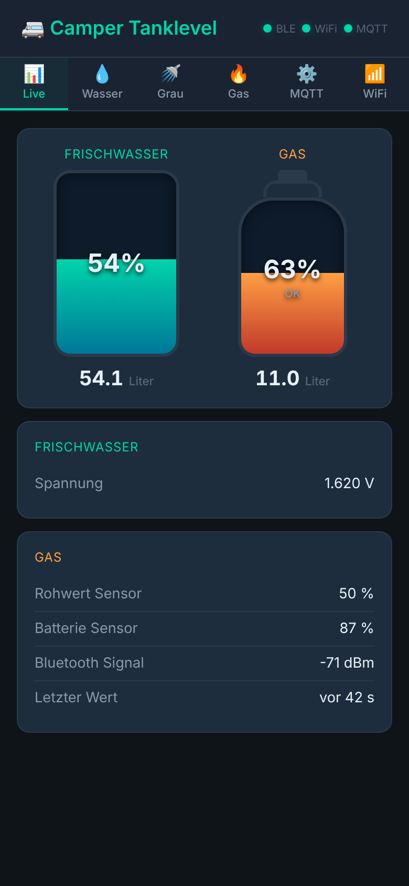
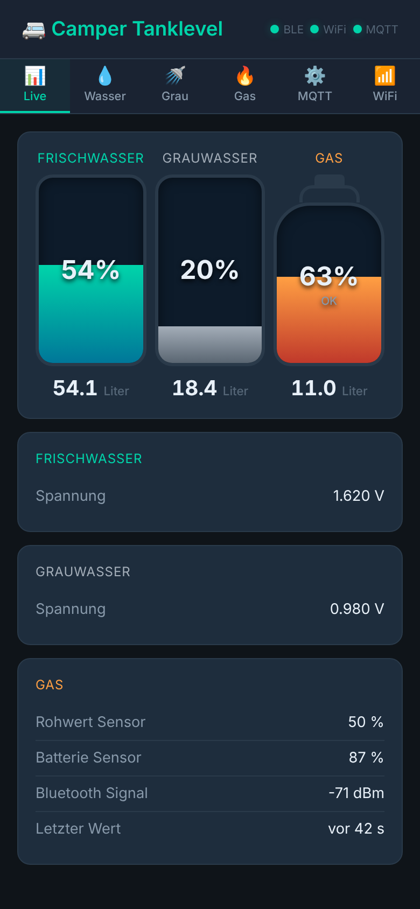
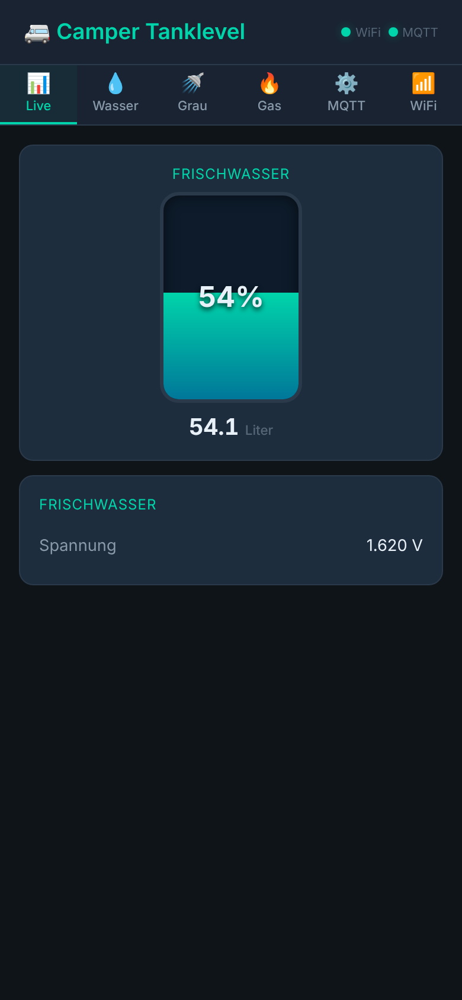
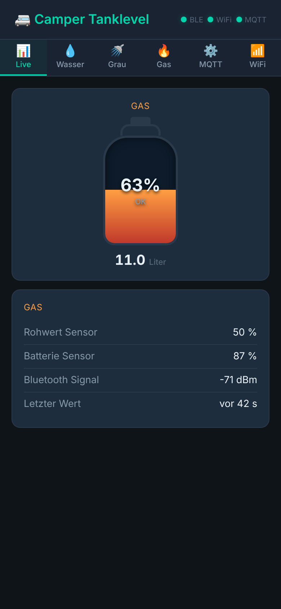
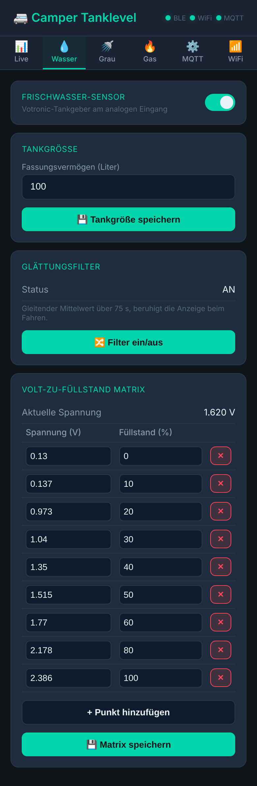
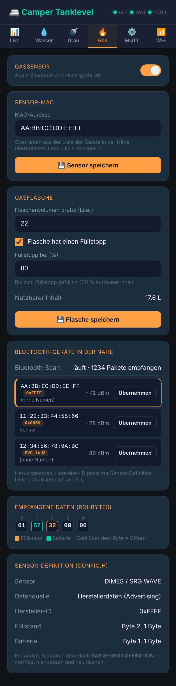
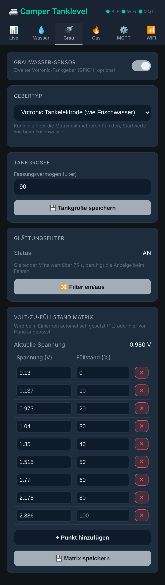
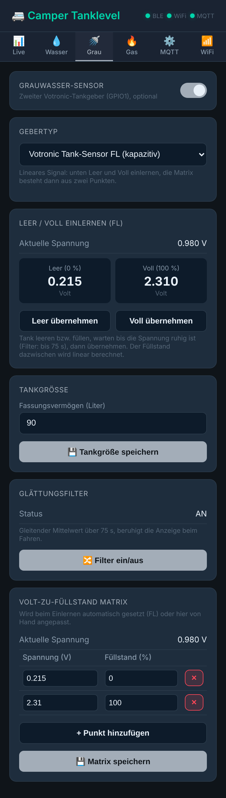
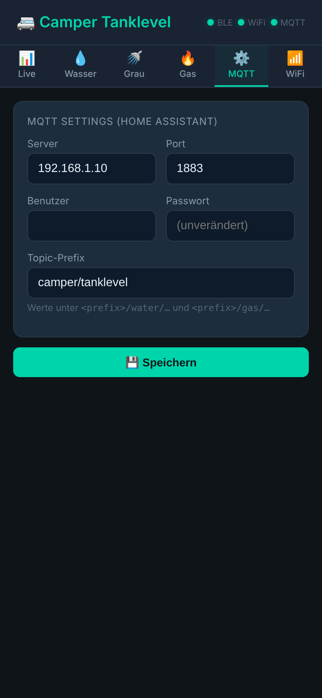
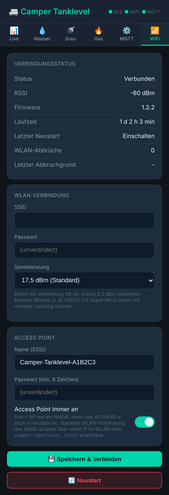

# Tanklevel Node – Frischwasser, Grauwasser + Gas auf einem ESP32

> **Achtung:** Ohne Gewähr, Nutzung auf eigene Gefahr – siehe [Haftungsausschluss](../../README.md#haftungsausschluss--nutzung-auf-eigene-gefahr). Die Gasanzeige ersetzt keinen Gaswarner und keine Sichtprüfung von Flasche und Anlage.

Eine Firmware für **einen** ESP32-C3 (oder klassischen ESP32), die zwei Projekte zusammenfasst und um Grauwasser erweitert:

- **Frischwasser** aus [camper-waterlevel](https://github.com/hflocki/camper-waterlevel): Votronic-Tankgeber am analogen Eingang, Volt-zu-Füllstand-Matrix, Glättungsfilter
- **Grauwasser** (optional): zweiter Votronic-Geber, wahlweise Tankelektrode (wie Frischwasser) oder kapazitiver Tank-Sensor FL, mit eigener Tankgröße, Matrix und Filter
- **SuperSense** statt Votronic (optional, je Tank): Füllstandssensor SuperSense (Pro, Solid, Laser) über eine Bluetooth-Verbindung, ohne Kabel am Tank (siehe [unten](#supersense-statt-votronic))
- **Gas** aus [camper-gaslevel](https://github.com/hflocki/camper-gaslevel): BLE-Gassensor (Standard: Rotarex DIMES / SRG WAVE), passiv über Bluetooth-Advertising, Füllstopp-Berechnung. Alternativ **Mopeka Pro** (Pro Check, Pro Check Universal, Pro Plus …) oder **Mopeka Standard** (Std Check), umschaltbar im Tab Gas

Alle Werte gehen per **MQTT** (mit Home-Assistant-Discovery) raus und sind in einer gemeinsamen **Web-Oberfläche** zu sehen und einzustellen. Jeder Sensor lässt sich einzeln ein- und ausschalten.

## Web-Oberfläche

**Live**

| Wasser + Gas (Standard) | Wasser + Grau + Gas |
| --- | --- |
|  |  |

| Nur Wasser | Nur Gas |
| --- | --- |
|  |  |

**Einstellungen**

| Wasser | Gas |
| --- | --- |
|  |  |

| Grau: Tankelektrode | Grau: Tank-Sensor FL |
| --- | --- |
|  |  |

| MQTT | WiFi |
| --- | --- |
|  |  |

Die Bilder zeigen Beispieldaten.

## Ordner

```
camper_tanklevel/        Sketch für die Arduino IDE (.ino + .cpp/.h)
camper_tanklevel/web/    Quelle der Web-Oberfläche (index.html)
camper_tanklevel/data/   LittleFS-Inhalt: index.html.gz (komprimiert, wird hochgeladen)
```

| Datei | Inhalt |
| --- | --- |
| `config.h` | Pins, Standardwerte, **GAS SENSOR DEFINITION** (Byte-Zuordnung) |
| `water_sensor.cpp` | ADC für Frisch- und Grauwasser, gleitender Mittelwert, Interpolation über die Matrix |
| `gas_sensor.cpp` | NimBLE-Scan, Dekodierung, Geräteliste, Füllstopp |
| `supersense_link.cpp` | Bluetooth-Verbindung zu SuperSense-Sensoren (je Tank eine), Dekodierung in `supersense_decode.h` (Kopie aus `firmware/_common`) |
| `mqtt_ha.cpp` | MQTT, HA-Discovery, Filter-Schalter |
| `webserver.cpp` | Web-UI (gzip), REST-API, Konfiguration in LittleFS |
| `wifi_manager.cpp` | WLAN mit AP-Fallback (Modem-Sleep für WiFi/BLE-Koexistenz) |
| `fwcheck.*`, `evlog.*` | Prüfung beim Firmware-Upload, Ereignis-Log (Kopien aus `firmware/_common`) |
| `safeguard.*` | Rückfall nach Update, WLAN-Änderung mit Rückweg (Kopie aus `firmware/_common`) |

## Hardware

- ESP32-C3 Super Mini (Standard), ESP32-S3 oder klassischer ESP32 – die Pins werden je nach Chip automatisch gewählt

| Sensor | ESP32-C3 | ESP32-S3 | Klassischer ESP32 | `config.h` |
| --- | --- | --- | --- | --- |
| Frischwasser (Votronic-Tankgeber) | **GPIO0** | **GPIO1** | GPIO34 | `ADC_PIN` |
| Grauwasser (Votronic-Tankgeber, optional) | **GPIO1** | **GPIO2** | GPIO35 | `GREY_ADC_PIN` |
| Gas (BLE) | keine Verkabelung, eingebautes Bluetooth | | | |

Beide Tankeingänge müssen ADC1-Pins sein (ADC2 funktioniert nicht, solange WLAN aktiv ist). GPIO2 beim C3 nicht verwenden, das ist ein Boot-Pin. Beim S3 ist GPIO0 ein Boot-Pin ohne ADC, deshalb dort GPIO1/GPIO2. Verkabelung der Tankgeber wie im [camper-waterlevel](https://github.com/hflocki/camper-waterlevel#verkabelung) beschrieben, der Grauwasser-Geber bekommt eine eigene, gleich aufgebaute Messschaltung.

**Grauwasser-Geber** – im Tab **Grau** unter „Gebertyp“ wählbar (Werkseinstellung in `config.h`: `GREY_SENSOR_TYPE`):

| Gebertyp | Kalibrierung |
| --- | --- |
| Votronic Tankelektrode (wie Frischwasser) | Matrix mit mehreren Punkten, Startwerte wie beim Frischwasser |
| Votronic Tank-Sensor FL (kapazitiv) | Lineares Signal: bei leerem Tank „Leer übernehmen“, bei vollem Tank „Voll übernehmen“ |

Für Abwasser ist der kapazitive FL die robustere Wahl, weil sich Ablagerungen kaum auf den Messwert auswirken. Beim Wechsel des Gebertyps wird die Grauwasser-Matrix auf die Startwerte des Typs zurückgesetzt. Vor dem Anschluss mit dem Multimeter die Signalspannung bei leerem und vollem Tank prüfen: Liegt sie über ca. 2,5 V, ist ein Spannungsteiler nötig. Bei langer Leitung zum Tank hilft ein abgeschirmtes Kabel, der Glättungsfilter beruhigt den Wert zusätzlich.

## Arduino IDE

Board-Paket, gemeinsame Bibliotheken, Board-Einstellungen, erstes Flashen, LittleFS-Plugin und Hilfe bei Upload-Problemen: **[docs/ARDUINO.md](../../docs/ARDUINO.md)**. Hier nur, was für dieses Gerät gilt.

| Einstellung | Wert |
| --- | --- |
| Board | ESP32-C3 Super Mini, Flash Size 4MB. ESP32-S3 geht auch (PSRAM passend zum Board, z. B. N16R8 → „OPI PSRAM“) |
| Partition Scheme | ⚠️ **Minimal SPIFFS** – WLAN + Bluetooth ergeben ca. 1,43 MB und passen nicht in die Standard-Partition |
| Zusätzliche Bibliothek | NimBLE-Arduino 2.5.1 |
| Sketch | `camper_tanklevel/camper_tanklevel.ino` |
| Web-Oberfläche | als LittleFS-Image (Plugin siehe docs/ARDUINO.md). **Überschreibt die gespeicherte Konfiguration** (WLAN, MQTT, Matrix); nach einem reinen Firmware-Update nicht nötig |

Vor dem ersten Flashen in `config_local.h` `DEFAULT_OTA_PASSWORD` und `DEFAULT_AP_PASSWORD` setzen. Nach dem Hochladen von Sketch und LittleFS den ESP neu starten, der Access Point `Tanklevel-Node-XXXXXX` erscheint.

## Erstbenutzung

1. Beim ersten Start läuft nur der Access Point **`Tanklevel-Node-XXXXXX`** (Passwort aus `config.h`). `XXXXXX` sind die letzten 6 Stellen der WLAN-MAC des ESP, so lassen sich mehrere Geräte auseinanderhalten. Der Name ist im Tab WiFi änderbar.
2. Verbinden und `http://192.168.4.1` öffnen.
3. Tab **WiFi**: WLAN eintragen → Neustart.
4. Tab **MQTT**: Broker eintragen → Neustart.
5. Tab **Gas**: Sensor aus der Liste „Bluetooth-Geräte in der Nähe“ übernehmen, Flaschengröße und Füllstopp einstellen.
6. Tab **Wasser**: Tankgröße und ggf. Matrix anpassen (Standard: Votronic-Referenzwerte).
7. Optional Tab **Grau**: Grauwasser-Sensor einschalten (Neustart), Gebertyp wählen, Tankgröße einstellen und kalibrieren (Matrix bzw. Leer/Voll einlernen).

## Probleme beim Hochladen

Siehe **[docs/ARDUINO.md → Probleme beim Hochladen](../../docs/ARDUINO.md#probleme-beim-hochladen)** (Firmware und LittleFS).

## MQTT / Home Assistant

Basis-Topic `camper/tanklevel` (in der Web-UI änderbar): Frischwasser unter `…/water/…`, Grauwasser unter `…/grey/…`, Gas unter `…/gas/…`. Alle Topics und Befehle: **[docs/TOPICS.md](../../docs/TOPICS.md#tanks-campertanklevel)**.

In Home Assistant erscheint **ein** Gerät „Tanklevel Node“ mit allen Entitäten.

**Umstieg von den Einzelprojekten:** Die alten Geräte „Camper Wasserlevel Sensor“ und „Camper Gaslevel Sensor“ bleiben in HA stehen, weil ihre Discovery-Nachrichten retained sind. Zum Entfernen in HA unter *Einstellungen → Geräte* löschen oder die Topics `homeassistant/sensor/camper_water/#`, `homeassistant/switch/camper_water/#` und `homeassistant/sensor/camper_gaslevel/#` mit leerer Nachricht (retained) überschreiben.

## WLAN-Probleme

Im Tab **WiFi** stehen Laufzeit, Grund des letzten Neustarts und die Zahl der WLAN-Abbrüche mit dem letzten Abbruchgrund. Damit lässt sich unterscheiden:

| Anzeige | Bedeutung | Abhilfe |
| --- | --- | --- |
| Laufzeit springt zurück, Neustart „Brownout“ | Spannung bricht beim Senden ein | Besseres Netzteil, kürzere Leitung, Kondensator an 3,3 V |
| Neustart „Absturz“ / „Watchdog“ | Firmware stürzt ab | Serial Monitor mitlaufen lassen; beim S3 PSRAM-Einstellung prüfen |
| Abbrüche mit `BEACON_TIMEOUT` | Signal zu schwach oder gestört | Sendeleistung senken (8,5 dBm), Abstand zum Router, AP nur als Notfall |
| Abbrüche mit `NO_AP_FOUND` | Router nicht sichtbar / Kanal gewechselt | Router-Kanal fest einstellen, Mesh/Band-Steering prüfen |
| Abbrüche mit `AUTH_EXPIRE`, `4WAY_HANDSHAKE_TIMEOUT` | Anmeldung scheitert | Passwort prüfen, WPA2 statt WPA3 |

**Sendeleistung** (Standard 17,5 dBm) und **Access Point immer an** (Standard an) sind im Tab WiFi einstellbar. Mit „AP nur als Notfall“ bleibt der eigene Access Point aus, solange das WLAN steht. Erst nach 60 s ohne WLAN geht er an. Das Gerät ist dann über seine IP oder `http://tanklevel-node.local` erreichbar.

## Sensoren ein- und ausschalten

Frischwasser und Gas sind standardmäßig an, Grauwasser ist aus. Jede Kombination ist möglich:

- **In `config.h`** (Werkseinstellung beim ersten Start):
  ```cpp
  #define WATER_ENABLED         1      // 1 = on, 0 = off
  #define GREY_ENABLED          0      // 1 = on, 0 = off
  #define GAS_ENABLED           1      // 1 = on, 0 = off
  ```
- **In der Web-UI:** oben im Tab **Wasser**, **Grau** bzw. **Gas** gibt es einen Schalter. Danach startet das Gerät neu.

Ein ausgeschalteter Sensor verschwindet von der Live-Seite und aus Home Assistant (die Entitäten werden per MQTT entfernt). Ist Gas aus und kein Tank auf SuperSense gestellt, wird Bluetooth gar nicht gestartet.

## SuperSense statt Votronic

Frisch- und Grauwasser können statt des analogen Votronic-Gebers einen **SuperSense**-Füllstandssensor (Pro, Solid, Laser) nutzen. Im Tab **Wasser** bzw. **Grau** unter **Gebertyp** „SuperSense (Bluetooth)“ wählen, das Gerät startet neu. Danach in der Karte **SuperSense-Sensor** auf **Suchen** tippen (Geräte mit SuperSense-Dienst stehen oben), die MAC übernehmen und speichern.

- Der ESP hält eine Bluetooth-Verbindung zum Sensor, schickt einmal den Startbefehl und bekommt dann laufend die Werte. Keine Kopplung, keine PIN.
- **Einheit noch nicht bestätigt:** Laut Quelle liefert der Sensor den Füllstand in ml; mit 4 Stellen reicht das aber nur bis knapp 10 L. Deshalb gibt es das Feld **Liter je Rohwert-Einheit** (Standard 0,001) und die Anzeige **Rohwert**: bei bekanntem Inhalt den Rohwert ablesen und Faktor = Liter ÷ Rohwert eintragen. Prozent = Liter ÷ Tankgröße.
- Der Glättungsfilter wirkt auf den Rohwert, die Volt-Matrix wird nicht gebraucht. Ohne neue Werte (länger als 70 s) bleibt der letzte Füllstand stehen, der Status zeigt „Keine Daten“ bzw. „Nicht erreichbar“.
- Solange der ESP verbunden ist, kommt die Hersteller-App meist nicht an den Sensor: **Für App freigeben** trennt die Verbindung für 30 Minuten.
- MQTT: statt `…/voltage` kommen `…/ss_raw`, `…/temperature`, `…/ble_rssi` und `…/ble_state` ([TOPICS.md](../../docs/TOPICS.md#tanks-campertanklevel)).
- Dieselbe Dekodierung nutzt das Plugin `supersense` im [ble-Node](../ble), für Tanks, die nicht am Tanklevel-Node hängen.

## Mopeka-Sensoren

Im Tab **Gas** unter **Sensortyp** das passende Modell wählen und speichern:

| Sensortyp | Modelle | Hersteller-ID in der Geräteliste |
|---|---|---|
| Mopeka Pro | Pro Check (auch Lippert BottleCheck), Pro Check Universal, Pro Plus, Pro-200, TD40/TD200 | `0059` |
| Mopeka Standard | Std Check (älteres Modell, auch XL und baugleiche Varianten) | `000D` |

Beim **Standard** rechnet der ESP die Füllhöhe selbst aus den Ultraschall-Echos. Die Schallgeschwindigkeit hängt vom Gas ab, deshalb gibt es dort zusätzlich das Feld **Propan-Anteil**: Deutsche Flaschen sind reines Propan (100 %), Mischgas z. B. 60 %, der Rest wird als Butan gerechnet.

Mopeka misst per Ultraschall die **Füllhöhe in mm** von unten durch die Flaschenwand. Der Füllstand ergibt sich aus „Leer bei“ und „Voll bei“:

| Flaschentyp | Leer | Voll |
|---|---|---|
| Europa 6 kg | 38 mm | 336 mm |
| Europa 11 kg | 38 mm | 366 mm |
| Europa 14 kg | 38 mm | 467 mm |
| USA 20 lb | 38 mm | 254 mm |

Für andere Flaschen „Eigene Werte“ wählen und die angezeigte Füllhöhe einmal mit voller und einmal mit fast leerer Flasche ablesen. Messungen mit schlechter Qualität (z. B. Sensor verrutscht, Flasche fast leer) werden ignoriert, der letzte gute Wert bleibt stehen; die Qualität ist im Tab **Live** und per MQTT sichtbar. Der Inhalt in Litern wird aus Füllstand × Flaschenvolumen × Füllstopp berechnet.

Die Dekodierung der Pro-Sensoren folgt der MIT-lizenzierten Bibliothek [mopeka-iot-ble](https://github.com/Bluetooth-Devices/mopeka-iot-ble), die auch Home Assistant verwendet. Für den Standard ist die Dekodierung eine eigene Umsetzung; das Datenformat ist in der ESPHome-Komponente [mopeka_std_check](https://esphome.io/components/sensor/mopeka_std_check/) dokumentiert.

## Anderer Gassensor

Block **GAS SENSOR DEFINITION** in `config.h` anpassen (Datenquelle, Hersteller-ID/UUID, Byte-Offsets). Der Tab **Gas** zeigt die empfangenen Rohbytes mit Offsets, damit sich die Zuordnung leicht finden lässt.

## Batterie des Gassensors

Der ESP scannt **passiv**: Er hört nur die Advertising-Pakete mit, die der Sensor ohnehin regelmäßig sendet. Es gibt keine Scan-Anfragen, keine Verbindung und kein Pairing. Die Batterielaufzeit des Sensors ändert sich dadurch nicht.

## Web-Login

Im Tab **MQTT** unter „Web-Oberfläche Login“ Benutzer und Passwort setzen. Dann fragt der Browser beim Öffnen danach (HTTP Basic Auth, gilt auch für die Live-Daten). Leerer Benutzer = kein Login. Login vergessen: im seriellen Monitor `noauth` senden.

## Serieller Monitor

115200 Baud. Befehle: `read`, `scan` (BLE-Geräte), `filter` (Frischwasser-Filter umschalten), `noauth` (Web-Login entfernen), `help`.

## Updates ohne USB

| Was | Wie |
|---|---|
| Firmware | Arduino IDE → *Sketch → Kompilierte Binärdatei exportieren*, die `.bin` im Web-UI unter **WiFi → Firmware- & Web-Update** hochladen (Neustart), oder per Netzwerkport in der IDE (OTA-Passwort) |
| Web-Oberfläche | `data/index.html.gz` im Web-UI hochladen – ersetzt nur die Seite, ohne Neustart, Einstellungen bleiben |
| Komplettes LittleFS-Image | Nur per USB oder IDE-Netzwerkport; löscht dabei auch die Einstellungen (`config.json`) |

## Sicheres Firmware-Update und Ereignisse

Seit 1.8.0 trägt jede Firmware eine Kennung (`CAMPER-FW:tanklevel:<version>:<chip>;`, `fwcheck.*` aus `firmware/_common`). Im Web-UI unter **WiFi → Firmware- & Web-Update** steht die installierte Version. Eine gewählte Datei wird schon im Browser geprüft und beim Hochladen im Gerät noch einmal, bevor etwas aktiviert wird:

| Datei | Ergebnis |
| --- | --- |
| `.bin` dieses Geräts | Gerät, Version und Vergleich mit der installierten (neuer / gleich / älter, bei gleich oder älter mit Rückfrage) |
| `.merged.bin` aus der Arduino IDE | abgelehnt: das ist das komplette Flash-Abbild für USB, fürs Web-Update die `.bin` ohne „merged“ nehmen |
| `.bin` eines anderen Geräts oder Chips | abgelehnt, z. B. „Firmware für „tanklevel“, dieses Gerät ist „tanklevel““ |
| `.bin` ohne Kennung (ältere Firmware, fremde Datei) | gesperrt, mit „Ohne Kennung hochladen“ trotzdem möglich (für ein Downgrade auf eine Version vor 1.8.0) |
| `data/index.html.gz` | Web-Oberfläche, ohne Neustart |

Schlägt etwas fehl, nennt die Meldung den Grund statt nur „Update failed“. Die Karte **Ereignisse** darunter zeigt die letzten 24 Ereignisse: Start mit Grund (Einschalten, Absturz, Watchdog …), WLAN und MQTT verbunden/getrennt, Uploads mit Ergebnis, Rückfall und gespeicherte Einstellungen (`evlog.*`). Das Log bleibt bei Neustart, Absturz und Update erhalten, bei Stromausfall ist es leer. Updates über den Netzwerkport der Arduino IDE werden nicht geprüft, aber ebenfalls protokolliert.

## Absicherung gegen Aussperren

Damit das Gerät erreichbar bleibt, ohne dass jemand hinmuss (`safeguard.*` aus `firmware/_common`):

- **Rückfall nach Update:** Nach einem Firmware-Update über das Web-UI oder den IDE-Netzwerkport läuft die neue Version auf Probe. Hat sie nach 5 Minuten kein WLAN oder startet sie mehr als dreimal neu, startet der ESP wieder die vorherige Firmware (sie liegt noch im zweiten App-Bereich). Ab 1 Minute stabilem WLAN gilt die neue Version als gut. Flashen per USB wird nie zurückgerollt.
- **WLAN-Änderung mit Rückweg:** Werden SSID, Passwort geändert, während das Gerät verbunden ist, merkt es sich die funktionierenden Werte. Klappt die Verbindung mit den neuen nach dem Neustart nicht (etwa 1 Minute), setzt es die alten wieder ein und startet neu. Ist das Gerät beim Ändern gar nicht verbunden (Einrichtung über den Setup-AP), gelten die neuen Werte sofort.
- Was zuletzt passiert ist, steht im Web-UI unter **WiFi → Verbindungsstatus** in der Zeile **Absicherung**.

Der Schutz greift erst bei Updates, die von dieser Version **aus** gemacht werden. Das Update auf diese Version selbst ist noch nicht abgesichert.

## Versionen

Die laufende Version steht in der Web-Oberfläche des Geräts. Alle Änderungen je Version: [CHANGELOG.md](CHANGELOG.md) (steht auch im jeweiligen GitHub-Release).

## Fertige Firmware

Wird im Haupt-Repo per GitHub Actions gebaut, siehe [Fertige Firmware](../../README.md#fertige-firmware).

## Lizenz

GNU GPL Version 3 mit zusätzlichen Bedingungen (Urhebervermerk bleibt erhalten, veränderte Fassungen sind zu kennzeichnen), siehe [LICENSE](LICENSE) und [NOTICE.md](../../NOTICE.md). Name und Logo „VanNode“ sind nicht Teil der Lizenz: [NAME-UND-LOGO.md](../../NAME-UND-LOGO.md). SuperSense-Protokoll (eigene Umsetzung, kein Code übernommen) nach [adahmen/supersense-homeassistant](https://github.com/adahmen/supersense-homeassistant) (MIT).

Ohne Gewähr, Nutzung auf eigene Gefahr; die Haftung ist ausgeschlossen, soweit gesetzlich zulässig (siehe [NOTICE.md](../../NOTICE.md)). Produkt- und Firmennamen sind Marken ihrer Inhaber, VanNode hat keine Verbindung zu ihnen.

