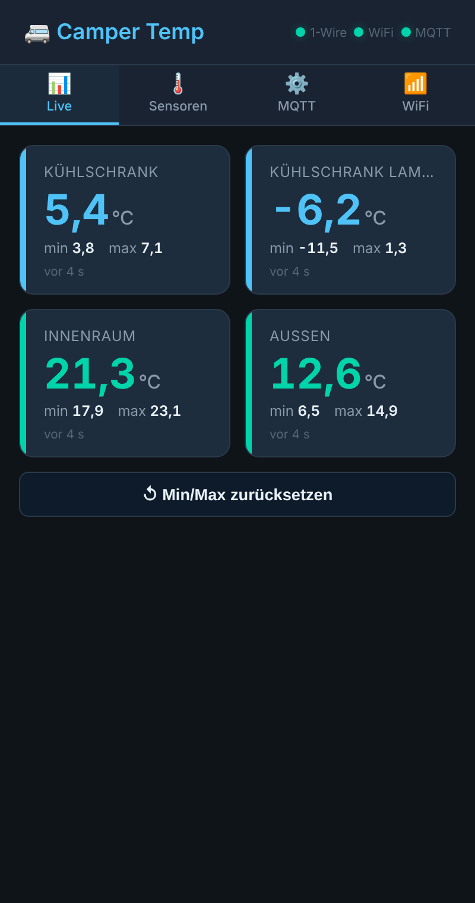
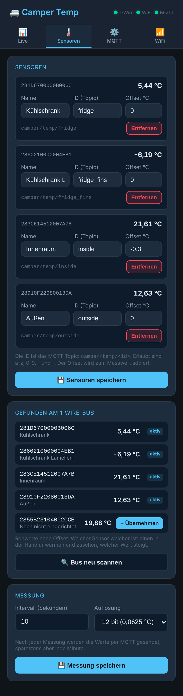
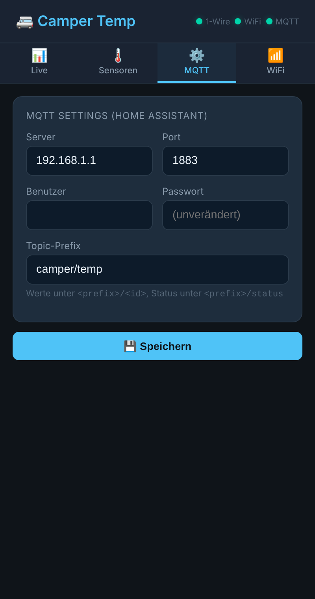
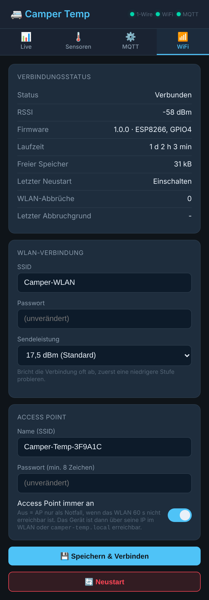

# Temp Node – DS18B20-Temperaturen per MQTT und Web-Oberfläche

> **Achtung:** Ohne Gewähr, Nutzung auf eigene Gefahr – siehe [Haftungsausschluss](../../README.md#haftungsausschluss--nutzung-auf-eigene-gefahr).

Firmware für einen ESP8266 (ESP-12E, NodeMCU, Wemos D1 mini) oder ESP32-C3, die bis zu **8 DS18B20-Temperatursensoren** an einem 1-Wire-Bus ausliest – z. B. Kühlschrank, Gefrierfach, Innenraum und außen.

- Sensoren werden am Bus **automatisch gefunden** und in der Web-UI benannt, keine Adressen im Code
- Werte per **MQTT** mit Home-Assistant-Discovery
- Web-Oberfläche mit Live-Werten, Min/Max seit Start, Offset-Korrektur je Sensor
- **Alarm-Grenzwerte** je Sensor (z. B. „Kühlschrank über 8 °C seit 15 min“), per MQTT auch ohne Home Assistant nutzbar, das [display-node](../display) zeigt sie als Warnung
- Login für die Web-Oberfläche (ab Werk `admin` / `admin`)
- Access Point beim ersten Start, WLAN/MQTT im Browser einstellen, OTA-Updates

## Web-Oberfläche

| Live | Sensoren |
|---|---|
|  |  |

| MQTT | WiFi |
|---|---|
|  |  |

Die Bilder zeigen Beispieldaten.

## Ordner

```
camper_temp/        Sketch für die Arduino IDE (.ino + .cpp/.h)
camper_temp/web/    Quelle der Web-Oberfläche (index.html)
camper_temp/data/   LittleFS-Inhalt: index.html.gz (komprimiert, wird hochgeladen)
```

| Datei | Inhalt |
|---|---|
| `config.h` | Pin, Standardwerte, Anzahl Sensoren |
| `temp_sensor.cpp` | 1-Wire-Busscan, nicht blockierende Messung, Plausibilitätsprüfung, Min/Max |
| `mqtt_ha.cpp` | MQTT, HA-Discovery, Aufräumen gelöschter/umbenannter Sensoren |
| `webserver.cpp` | Web-UI (gzip), REST-API, Konfiguration in LittleFS |
| `wifi_manager.cpp` | WLAN mit AP-Fallback (ESP8266 und ESP32) |

## Hardware

| | ESP8266 (NodeMCU / D1 mini) | ESP32-C3 |
|---|---|---|
| DS18B20 DATA | **GPIO4** (D2) | GPIO4 |
| DS18B20 VDD | 3,3 V | 3,3 V |
| DS18B20 GND | GND | GND |

Zwischen DATA und 3,3 V gehört **ein 4,7-kΩ-Pull-up** (einmal pro Bus, nicht pro Sensor). Alle Sensoren hängen parallel an denselben drei Leitungen. Bei langen Leitungen (> 5 m) oder vielen Sensoren ggf. 2,2 kΩ verwenden. Beim ESP8266 GPIO0, GPIO2 und GPIO15 meiden (Boot-Pins). Anderer Pin: `ONEWIRE_PIN` in `config.h`.

## Arduino IDE

Board-Paket, gemeinsame Bibliotheken, Board-Einstellungen, erstes Flashen, LittleFS-Plugin und Hilfe bei Upload-Problemen: **[docs/ARDUINO.md](../../docs/ARDUINO.md)**. Hier nur, was für dieses Gerät gilt.

| Einstellung | Wert |
|---|---|
| Board | ESP8266 (NodeMCU / D1 mini, Flash Size **4MB (FS:1MB OTA:~1019KB)**) oder ESP32-C3 Super Mini |
| Zusätzliche Bibliotheken | OneWire 2.3.8, DallasTemperature 4.0.6; auf ESP8266 ESP Async TCP 2.0.0 statt Async TCP |
| Sketch | `camper_temp/camper_temp.ino` |
| Web-Oberfläche | als LittleFS-Image (Plugin siehe docs/ARDUINO.md). **Überschreibt die gespeicherte Konfiguration** |

Vor dem ersten Flashen in `config_local.h` `DEFAULT_OTA_PASSWORD` und `DEFAULT_AP_PASSWORD` setzen. Spätere Firmware-Updates gehen per OTA (`temp-node` unter Netzwerk-Ports) oder über die Web-Oberfläche.

## Erstbenutzung

1. Beim ersten Start läuft nur der Access Point **`Temp-Node-XXXXXX`** (Passwort aus `config.h`). `XXXXXX` sind die letzten 6 Stellen der WLAN-MAC.
2. Verbinden und `http://192.168.4.1` öffnen.
3. Tab **WiFi**: WLAN eintragen → Neustart.
4. Tab **MQTT**: Broker eintragen → Neustart.
5. Tab **Sensoren**: Unter „Gefunden am 1-Wire-Bus“ jeden Sensor mit **+ Übernehmen** hinzufügen, Name und ID vergeben, **Sensoren speichern**. Welcher Sensor welcher ist: einen in der Hand anwärmen und zusehen, welcher Wert steigt.

Eine feste IP vergibt man am einfachsten als DHCP-Reservierung im Router; im Netz ist das Gerät auch als `temp-node.local` erreichbar.

## MQTT / Home Assistant

Basis-Topic `camper/temp` (in der Web-UI änderbar): je Sensor `…/<id>` in °C, Alarme unter `…/<id>/alarm`, `…/alarm` und `…/alarm_text`, alle Sensoren als JSON in `…/sensors`. Alle Topics und Befehle: **[docs/TOPICS.md](../../docs/TOPICS.md#temperaturen-campertemp)**.

Gesendet wird nach jeder Messung (Intervall in der Web-UI, Standard 10 s), spätestens jede Minute. Liefert ein Sensor keinen gültigen Wert (abgezogen, Kabelbruch, 85-°C-Startwert), wird kein Wert gesendet und die Entität in HA als nicht verfügbar markiert.

In Home Assistant erscheint **ein** Gerät „Temp Node“ mit einer Temperatur-Entität pro Sensor, einem Alarm-Binärsensor pro Sensor mit Grenzwerten, dem Gesamtalarm „Temperatur-Alarm“ und dem Alarmtext. Die `unique_id` basiert auf der Sensoradresse: Umbenennen oder eine neue ID behält die Historie. Wird ein Sensor entfernt, verschwindet auch seine Entität.

**Umstieg von ESPHome:** Das alte ESPHome-Gerät in HA unter *Einstellungen → Geräte & Dienste → ESPHome* löschen. Die Sensoradressen aus dem ESPHome-Log tauchen in der Web-UI unter „Gefunden am 1-Wire-Bus“ wieder auf (ESPHome schreibt sie in umgekehrter Byte-Reihenfolge: `0x0b000000671daa28` entspricht `28AA1D670000000B`).

## Alarm-Grenzwerte

Im Tab **Sensoren** hat jeder Sensor drei Felder:

| Feld | Bedeutung |
|---|---|
| Alarm unter °C | Alarm, wenn der Wert darunter liegt (leer = aus) |
| Alarm über °C | Alarm, wenn der Wert darüber liegt (leer = aus) |
| Verzögerung min | So lange muss die Grenze ununterbrochen verletzt sein (0–240, 0 = sofort) |

Beispiele: Kühlschrank „über 8 °C, 15 min“ (Türöffnen löst nichts aus), Gefrierfach „über −12 °C, 30 min“, Innenraum „unter 5 °C, 0 min“ als Frostwarnung.

Der Alarm geht weg, sobald der Wert 0,5 °C zurück im erlaubten Bereich ist, ohne Verzögerung. So flackert er nicht, wenn der Wert genau an der Grenze liegt. Liefert ein Sensor keine Messung mehr, bleibt sein Alarmzustand stehen; der Ausfall selbst ist über `<id>/available` sichtbar. Nach dem Speichern der Sensorliste beginnt die Verzögerung neu.

Live-Seite: Kacheln im Alarm haben einen roten Rahmen, darüber steht der Alarmtext.

## Web-Login

Im Tab **MQTT** unter „Web-Oberfläche Login“ Benutzer und Passwort setzen. Dann fragt der Browser beim Öffnen danach (HTTP Basic Auth, gilt auch für die Live-Daten). Die Anmeldung ist immer an, ab Werk `admin` / `admin` (siehe [README](../../README.md#setup-wlan-und-passwörter-ab-werk)); leere Felder behalten den gespeicherten Wert. Login vergessen: im seriellen Monitor `noauth` senden, dann gilt wieder der Werks-Login.

## Serieller Monitor

115200 Baud. Befehle: `read` (Werte), `scan` (Bus neu durchsuchen), `bus` (gefundene Adressen), `noauth` (Web-Login auf Werks-Login zurücksetzen), `help`.

## Updates ohne USB

| Was | Wie |
|---|---|
| Firmware | Arduino IDE → *Sketch → Kompilierte Binärdatei exportieren*, die `.bin` im Web-UI unter **WiFi → Firmware- & Web-Update** hochladen (Neustart), oder per Netzwerkport in der IDE (OTA-Passwort) |
| Web-Oberfläche | `data/index.html.gz` im Web-UI hochladen – ersetzt nur die Seite, ohne Neustart, Einstellungen bleiben |
| Komplettes LittleFS-Image | Nur per USB oder IDE-Netzwerkport; löscht dabei auch die Einstellungen (`config.json`) |

## Sicheres Update, Ereignisse und Rückfall

Seit 1.3.0 hat jede Firmware eine Kennung (`CAMPER-FW:temp:<version>:<chip>;`) und dieselbe Absicherung wie alle VanNode-Geräte (`fwcheck.*`, `evlog.*`, `safeguard.*` aus `firmware/_common`):

- **Prüfung beim Update** (Web-UI unter **WiFi → Firmware- & Web-Update**): Die installierte Version steht dabei. Eine gewählte Datei wird schon im Browser und beim Hochladen im Gerät noch einmal geprüft, bevor etwas aktiviert wird. Abgelehnt werden eine `.merged.bin` (komplettes Flash-Abbild für USB), Firmware für ein anderes Gerät oder einen anderen Chip und zu große Dateien. Eine Datei ohne Kennung (Version vor 1.3.0) geht nur mit „Ohne Kennung hochladen“. Fehler stehen im Klartext da statt „Update failed“.
- **Ereignisse:** Die letzten Ereignisse (Start mit Grund, WLAN und MQTT verbunden/getrennt, Uploads mit Ergebnis, Rückfall, gespeicherte Einstellungen) stehen in der Web-Oberfläche. Sie bleiben bei Neustart, Absturz und Update erhalten, nach einem Stromausfall ist das Log leer.
- **Rückfall nach Update:** Hat eine neue Firmware nach 5 Minuten kein WLAN oder startet sie mehr als dreimal neu, startet wieder die vorherige. Kam das Update über den Setup-AP (ohne WLAN), wird nur auf Neustart-Schleifen geachtet.
- **WLAN-Änderung mit Rückweg:** Werden die WLAN-Daten geändert, während das Gerät verbunden ist, merkt es sich die funktionierenden. Klappt die Verbindung mit den neuen nach dem Neustart etwa 1 Minute lang nicht, kommen die alten zurück.
- **ESP8266:** Prüfung über die Kennung (Gerät und Chip), das Log liegt nur im RAM (nach jedem Neustart leer), den Rückfall gibt es nur auf dem ESP32-C3 (der ESP8266 hat dafür keine zwei App-Bereiche mit Umschaltung wie der ESP32).

## Versionen

Die laufende Version steht in der Web-Oberfläche des Geräts. Alle Änderungen je Version: [CHANGELOG.md](CHANGELOG.md) (steht auch im jeweiligen GitHub-Release).

## Fertige Firmware

Wird im Haupt-Repo per GitHub Actions gebaut, siehe [Fertige Firmware](../../README.md#fertige-firmware).

## Lizenz

GNU GPL Version 3 mit zusätzlichen Bedingungen (Urhebervermerk bleibt erhalten, veränderte Fassungen sind zu kennzeichnen), siehe [LICENSE](LICENSE) und [NOTICE.md](../../NOTICE.md). Name und Logo „VanNode“ sind nicht Teil der Lizenz: [NAME-UND-LOGO.md](../../NAME-UND-LOGO.md).

Ohne Gewähr, Nutzung auf eigene Gefahr; die Haftung ist ausgeschlossen, soweit gesetzlich zulässig (siehe [NOTICE.md](../../NOTICE.md)). Produkt- und Firmennamen sind Marken ihrer Inhaber, VanNode hat keine Verbindung zu ihnen.

